<h1 align="center">Tela</h1>

<p align="center">
  <a href="https://pkg.go.dev/github.com/kuronosu/tela"></a>
</p>

<p align="center">
  A desktop UI framework in <strong>pure Go</strong>.<br>
  No cgo, no webview, no native toolkits. Tailwind classes, React-style hooks.
</p>

<p align="center">
  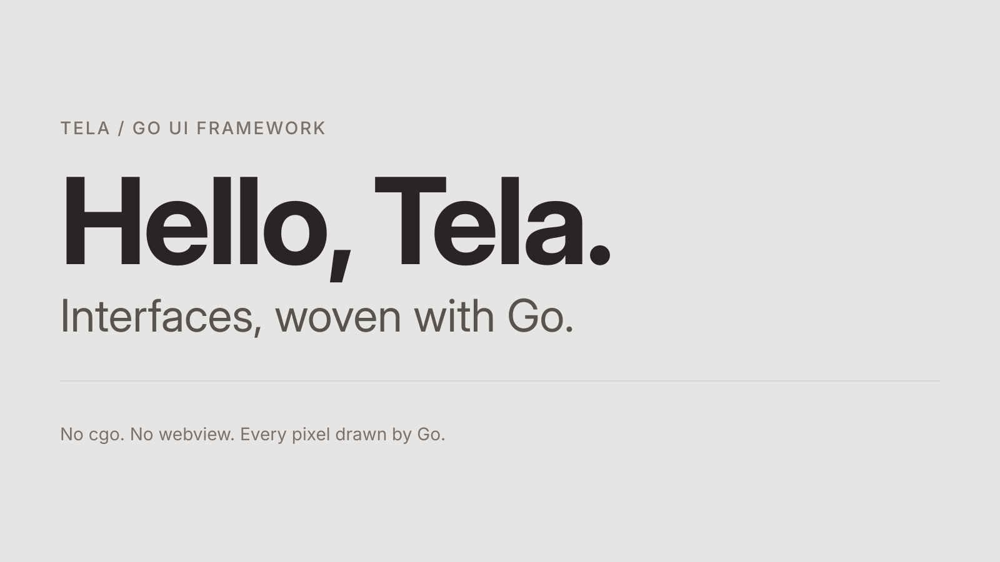
</p>

Tela draws every pixel itself, like Flutter or a browser, with its own
rasterizer, text layout and flexbox engine. You write function components with
hooks and style them with the Tailwind v4 vocabulary; the same tree renders to
a window on Linux or, with no window at all, to a PNG you can look at and a
text tree you can read. That last part is on purpose: Tela is designed so both
people and LLM agents can build good-looking interfaces without trial and
error.

> **Status: pre-1.0 (v0.6.0).** Phases 1–6 are done and tagged: Linux
> (Wayland, X11) and Windows windows, text inputs and IME, CSS grid,
> transitions and animations, glass effects. macOS is not there yet. The public API (`tela`, `h`) may
> still break between minor versions. See [Project status](#project-status).

## Contents

- [Why Tela](#why-tela)
- [A first look](#a-first-look)
- [Quick start](#quick-start)
- [Examples](#examples)
- [Styling](#styling)
- [State and hooks](#state-and-hooks)
- [Testing without a window](#testing-without-a-window)
- [Tooling for agents](#tooling-for-agents)
- [Project status](#project-status)
- [Documentation](#documentation)
- [Contributing](#contributing)
- [License](#license)

## Why Tela

- **Pure Go, always `CGO_ENABLED=0`.** Linux talks the Wayland and X11
  protocols over Unix sockets, Windows calls the system DLLs through
  `syscall`, and the macOS backend (planned) will use the Objective-C runtime
  without cgo. One `go build`,
  one static binary, easy cross-compilation.
- **Known vocabulary.** Names copy React (`UseState`, `UseEffect`, `Key`,
  `OnClick`) and classes copy Tailwind v4 verbatim. If an LLM would write it
  in React + Tailwind, it works here.
- **Real CSS semantics.** Block and flex layout checked against 828 Taffy
  fixtures and Chromium; box painting, gradients, shadows and blur compared to
  Chromium's pixels; text shaped with HarfBuzz (bidi, Arabic, CJK, color
  emoji).
- **Deterministic.** Embedded fonts and an own rasterizer: same tree, same
  pixels on every platform and architecture. Goldens are bit-exact on amd64
  and arm64.
- **Fast when it matters, silent when it doesn't.** Frames on demand, 0% CPU
  when idle, layers with exact damage tracking, and phase-deferred values that
  repaint or relayout one element without rebuilding anything. A 100,000-row
  `VirtualList` scrolls with a p95 of 2.3 ms per frame on the CPU rasterizer.
- **Observable.** Everything renders headlessly and can be inspected as an
  aria snapshot or a layout tree. Errors teach:
  `unknown class "rounded-xxl"; did you mean "rounded-2xl"?`.

## A first look

```go
package main

import (
	"github.com/kuronosu/tela"
	. "github.com/kuronosu/tela/h"
)

func Counter() tela.Node {
	count, setCount := tela.UseState(0)

	return Div(Class("flex flex-col items-center gap-6 p-10 rounded-3xl "+
		"bg-linear-to-br from-indigo-500 to-fuchsia-600 shadow-2xl"),
		H1(Class("text-5xl font-bold text-white tracking-tight"),
			Textf("Count: %d", count)),
		Button(Class("px-6 py-3 rounded-xl bg-white/15 text-white backdrop-blur "+
			"hover:bg-white/25 active:scale-95 transition"),
			OnClick(func(tela.MouseEvent) { setCount.Set(count + 1) }),
			Text("Increment"),
		),
	)
}

func main() {
	tela.Run(tela.App{Title: "Demo", Width: 800, Height: 600, Root: Counter})
}
```

<p align="center">
  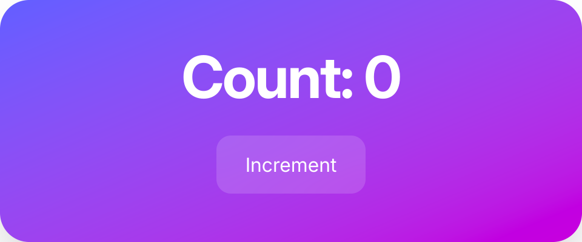
</p>

This is [`examples/counter`](examples/counter), and it is the one that
anchors the project: its render matches the same markup written in HTML +
Tailwind CSS and drawn by Chromium 152, with every box edge within 0.01 px and
pixels equal except glyph antialiasing.

## Quick start

You need Go 1.27 or newer, and on Linux a Wayland or X11 session.

```bash
git clone https://github.com/kuronosu/tela
cd tela

# Open a window
CGO_ENABLED=0 go run ./examples/counter

# Or render without a window, to a PNG
CGO_ENABLED=0 go run ./cmd/tela snapshot --size 480x200 --scale 2 \
    -o counter.png ./examples/counter

# Print the screen as text (an aria snapshot, in YAML)
CGO_ENABLED=0 go run ./cmd/tela inspect --size 800x600 ./examples/counter
```

The `inspect` output for the counter is what a screen reader, a test or an
agent sees:

```yaml
- 'heading "Count: 0" [level=1]'
- button "Increment"
```

> The `tela` command runs a package's own code, so it needs the `go` command
> and a package in a module that requires Tela (see [`cmd/tela`](cmd/tela)).

### Debug overlays

`TELA_DEBUG=layout,paint-flash,layers,fps,semantics` draws diagnostics on top
of a running app with Tela's own renderer, at no cost when off. Dev mode,
on in development builds and tests (`TELA_DEV=0` turns it off), reports
unknown classes, hook misuse with both call sites, and likely mistakes.

## Examples

Every screen lives in [`examples/`](examples), with its own README, goldens
and tests. They are the best way to see what the framework does today.

### Dashboard

A glassmorphism analytics dashboard, the showcase of phase 6: CSS grid,
`sticky` and `fixed`, translucent panels with `backdrop-blur` over an image,
springs, layout animations (`AnimateLayout`, `LayoutID`), `h.Presence`
dialogs and toasts in an `h.Portal`, and a light/dark switch. It runs at 60 fps
at 1080p on CPU rendering (p95 of 14.6 ms per frame on 4 cores; the benchmark
and the "glass budget" are in its README).

<p align="center">
  
  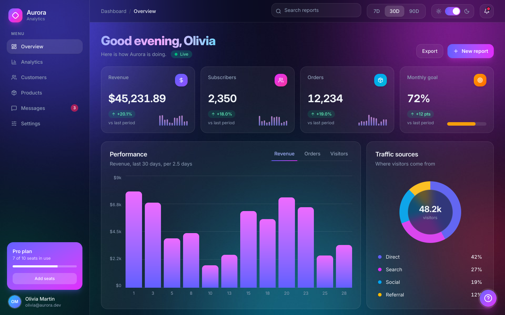
</p>

Dark mode is a class pair (`bg-white/55 dark:bg-white/5`); render it with
`tela snapshot --dark`.

### Signup form

A "Create your account" screen with every text field Tela has: `h.Input`
with `Type("email")`, `invalid:` and `peer-invalid:` styling, a password with
a show/hide toggle, an auto-growing `h.Textarea` with a live counter
(`BindValue` + `TextFn`), `h.Label`, implicit submission with Enter, and a
submit button that stays disabled until the form is valid.

<p align="center">
  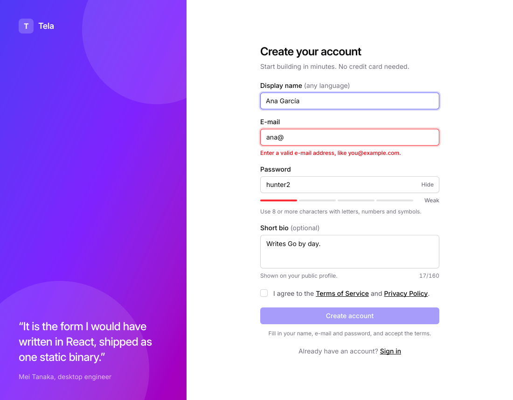
</p>

### More screens

| | |
|---|---|
| **[pricing](examples/pricing)**: a monthly/yearly switch, a highlighted gradient plan, `absolute` badges. <br>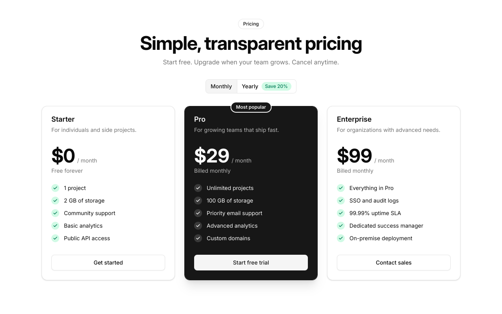 | **[settings](examples/settings)**: a whole form as one comparable value, switches, a theme picker, a dirty flag. <br>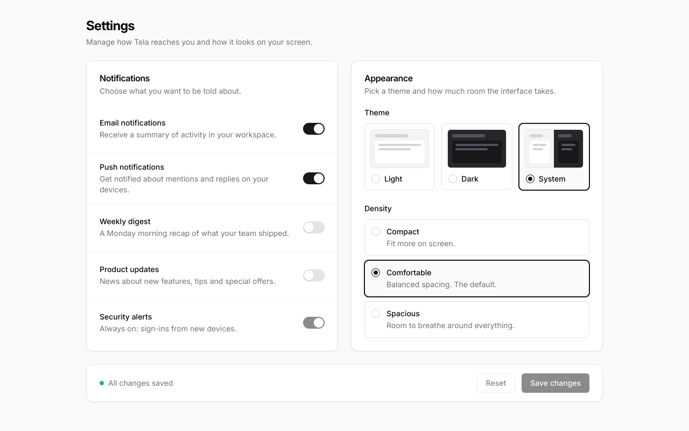 |
| **[player](examples/player)**: a progress bar that advances ten times a second without building anything (`UseValue` + `WidthFn`). <br>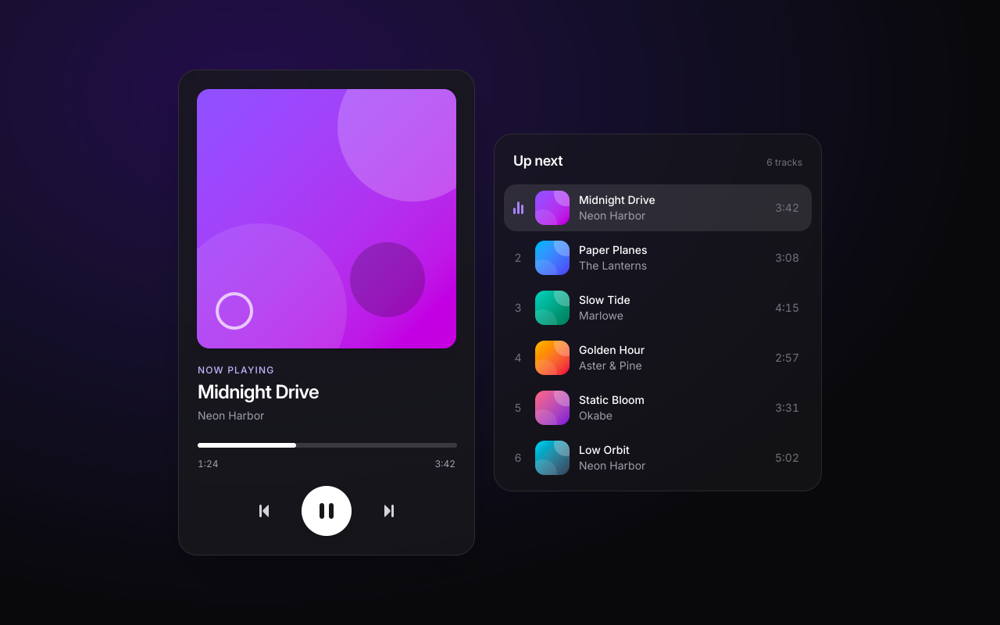 | **[board](examples/board)**: a kanban board with drag and drop between columns, using `OnDrag` and `TranslateFn`. <br>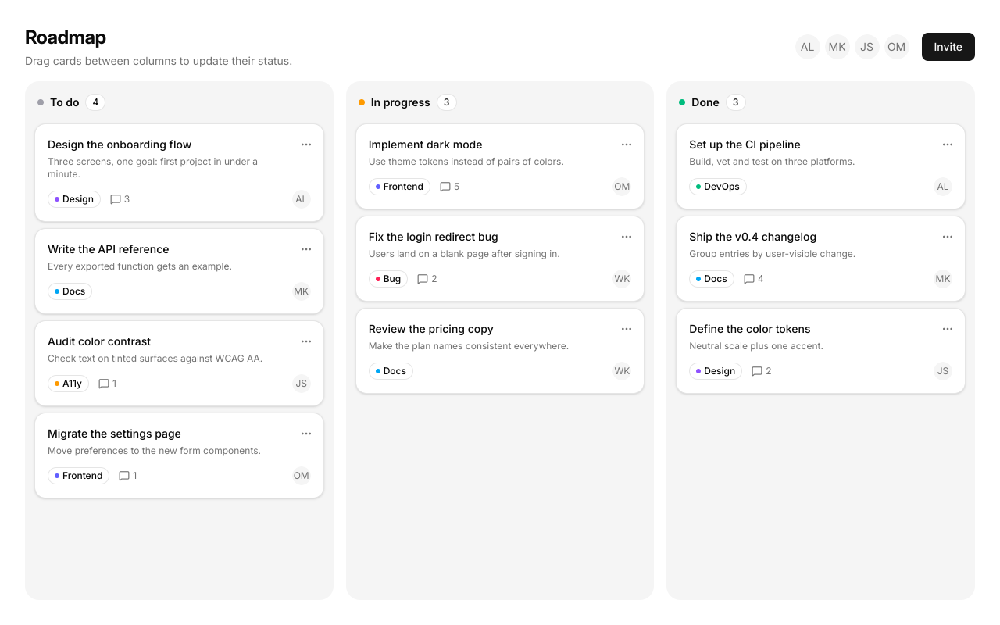 |
| **[shapes](examples/shapes)**: rounded cards, gradients, analytic shadows, blur and glass. <br>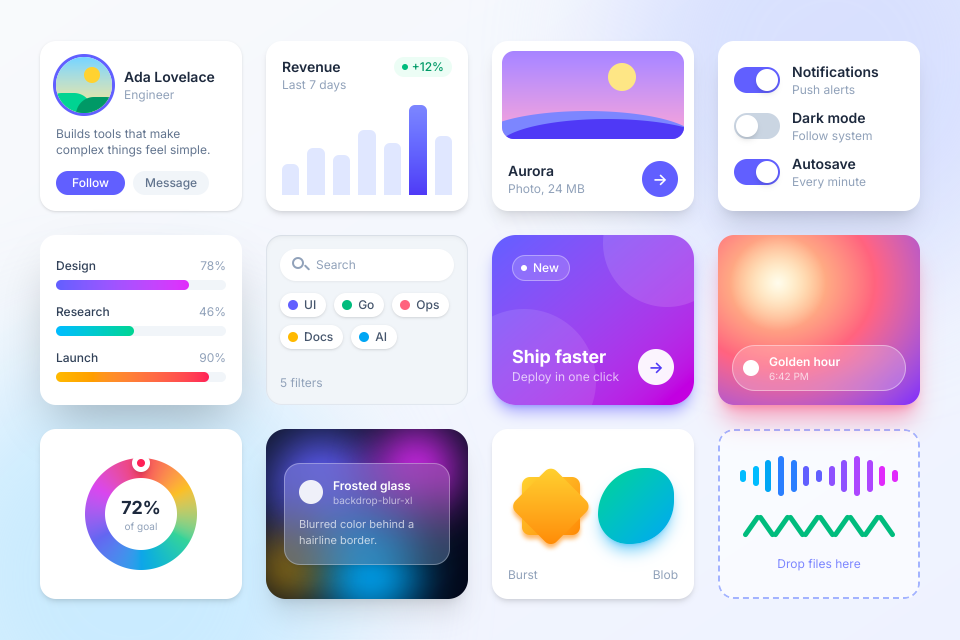 | **[text](examples/text)**: mixed-script paragraphs (Latin, Arabic, CJK, emoji), selection and carets. <br>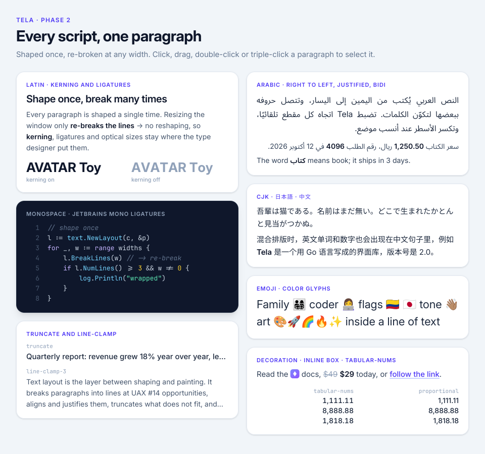 |

### Native look

**[native](examples/native)**: one file-explorer tree that looks native on
Windows 11, GNOME and KDE, each in light and dark. A theme is a set of class
strings (`bg-[#cce8ff]`, `rounded-[8px]`), a column order and some number
formats; `-theme=` and `-dark=` choose the look, and `-dark=auto` follows the
system.

<p align="center">
  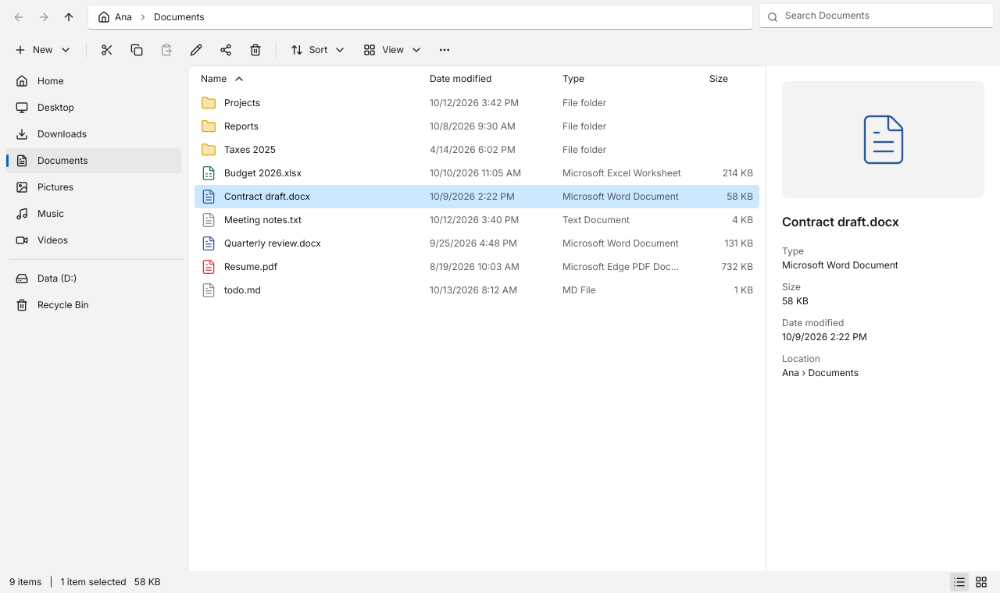
  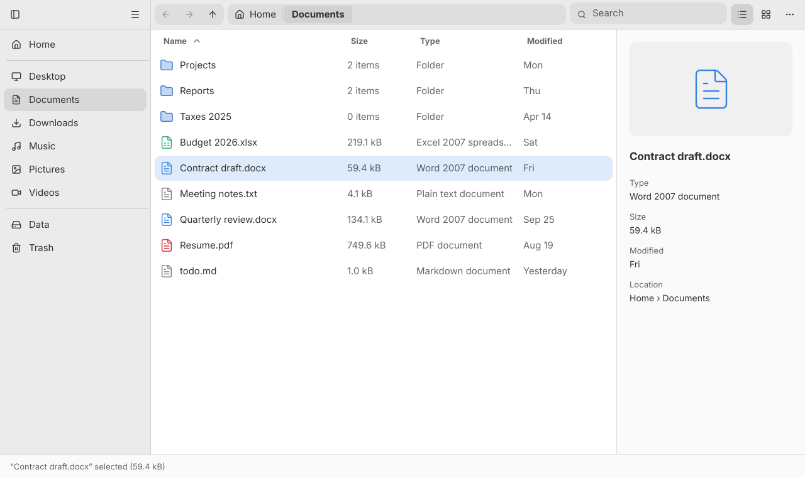
  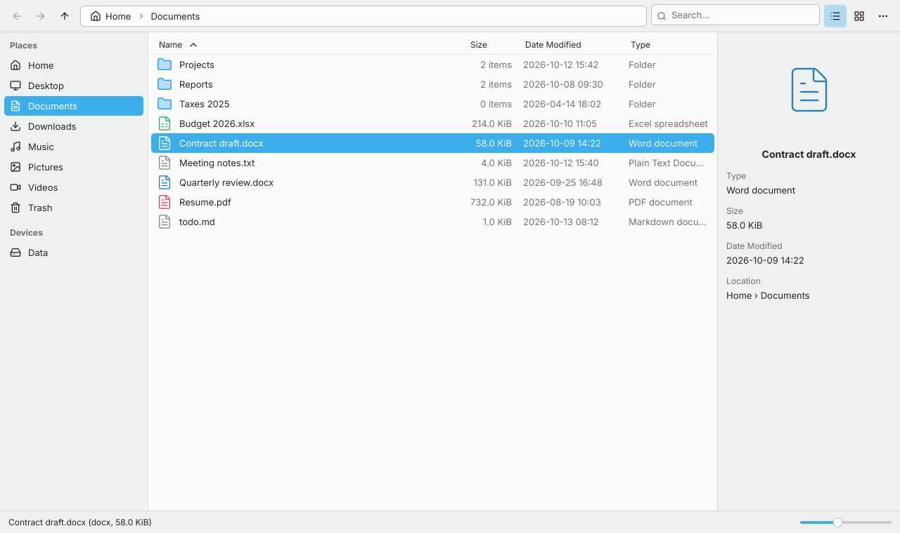
</p>

Also there: [`hello`](examples/hello), the screen at the top of this page;
[`virtuallist`](examples/virtuallist), 100,000 people in one
`h.VirtualList` with variable row heights and `ScrollToIndex`;
[`motion`](examples/motion), a dialog, a toast and a draggable card with
springs; and [`layout`](examples/layout), a reorderable list, an expanding
card and a sliding tab underline with layout animations.

## Styling

Classes are Tailwind v4's, generated from its theme and parsed into a typed
`ComputedStyle`: spacing, sizing, colors with `/NN` opacity, borders, radius,
shadows, gradients, typography, flex, grid, `relative`/`absolute`/`fixed`/
`sticky` positioning, overflow, transforms, filters and `backdrop-blur-*`,
`mix-blend-*`, `[clip-path:…]`, background images (`bg-[url(…)]` from files
registered with `tela.Assets`), `bg-clip-text`, transitions (`transition`,
`duration-*`, `ease-*`, `delay-*`), `animate-*`, arbitrary values
(`w-[calc(50%-8px)]`) and variants (`hover:`, `active:`, `focus:`,
`focus-visible:`, `disabled:`, `group-*`, `peer-*`, `dark:`, `motion-reduce:`,
`starting:`, `md:`/`lg:`). Typed helpers cover what a class cannot, such as
values that change every frame.

## State and hooks

`UseState`, `UseReducer`, `UseEffect`, `UseLayoutEffect`, `UseMemo`,
`UseCallback`, `UseRef`, `UseContext`, `UseId`, `UseMount`, `UseOnce`,
`UseInterval`, `UseGo`, plus `tela.UseValue` for
values that should repaint or relayout one element without rebuilding the
component that owns them. Component boundaries `tela.C`, `tela.CP` and
`tela.Memo` skip work when props are comparable and equal.

Animation builds on the same values: `tela.UseSpring`, `tela.UseTween` and
`tela.Animate` move a `Value` without rebuilding (`Velocity`, `OnDone` and
other options), `h.Presence` with `starting:` classes and `h.Exit` animates
enter and exit, and `h.AnimateLayout()` / `h.LayoutID(id)` animate layout
changes and shared elements, Motion style. `tela.UseColorScheme` and
`tela.SetColorScheme` read and switch light and dark.

```go
type RowProps struct{ Index int }

func Row(p RowProps) tela.Node { /* ... */ }

// Only rows that enter the viewport are built; a scroll that stays inside the
// built rows only repaints.
VirtualList(100_000, func(int) float32 { return 65 }, func(i int) tela.Node {
	return tela.CP(Row, RowProps{Index: i})
})
```

## Testing without a window

`telatest` mounts a component with no window, simulates input and compares
pixels or semantics. It finds elements the way an assistive technology does:

```go
func TestIncrement(t *testing.T) {
	app := telatest.Mount(t, tela.C(Counter), telatest.Size(800, 600))

	app.Click(telatest.ByRole("button", "Increment"))

	app.ExpectAria(`
		- 'heading "Count: 1" [level=1]'
		- button "Increment"
	`)
	app.Golden("counter_clicked.png")
}
```

Regenerate goldens with `TELA_UPDATE=1 CGO_ENABLED=0 go test ./...` and review
the diff.

## Tooling for agents

Because the whole pipeline is headless, a loop of *write → `tela snapshot` →
look at the PNG → `tela inspect` → fix* needs no window and no human. Unknown
classes come with suggestions, and `tela inspect --layout` prints boxes as
JSON. Planned: `tela lint`, `tela dev`, `tela mcp` and a `docs/llms.txt`
(phase 10).

## Project status

**Current version: [v0.6.0](CHANGELOG.md)**, tagged 2026-10-19. Phases 1–6
are done.

| Phase | Name | State |
|---|---|---|
| 1 | Pixels on screen: rasterizer, shadows, blur, Wayland and X11 windows | ✅ v0.1.0 |
| 2 | Text: shaping, bidi, Parley-style layout, selection, emoji | ✅ v0.2.0 |
| 3 | Tree, style, layout: reconciler, Tailwind classes, flex, `tela snapshot` | ✅ v0.3.0 |
| 4 | Interaction and state: hooks, pointer and keyboard, focus, scrolling, `VirtualList`, `telatest` | ✅ v0.4.0 |
| 5 | Windows and text editing: `win32`, `Input`/`Textarea`, IME, inline decorations | ✅ v0.5.0 |
| 6 | Advanced CSS and animation: grid, `fixed`/`sticky`, transitions, springs, layout animations, blend modes, clip-path, background images, fractional scaling | ✅ v0.6.0 |
| 7 | `aria` hooks, `kit` components, `tela add/lint/dev/mcp`, `llms.txt` | planned |
| 8 | macOS, optional GPU backend, accessibility, IME on X11 and macOS | planned |

### What works today

| | Linux Wayland | Linux X11 | Headless | Windows | macOS |
|---|---|---|---|---|---|
| Window and rendering | ✅ | ✅ | ✅ | ✅ | cross-compiles, no backend yet |
| Pointer, scroll, keyboard | ✅ | ✅ | ✅ (`telatest`) | ✅ | — |
| Text fields, clipboard | ✅ | ✅ | ✅ (`telatest`) | ✅ | — |
| IME (Japanese, Chinese, …) | ✅ (`text-input-v3`) | — (phase 13) | ✅ (injected) | ✅ (IMM32) | — |

Implemented: block, flex and grid layout with relative, absolute, fixed and
sticky positioning; Tailwind classes and variants; shaped text with fallback;
gradients, shadows, blur and backdrop blur, blend modes, clip paths,
background images, transforms and opacity layers; CSS transitions and
`animate-*`; springs, tweens, enter/exit and layout animations; portals;
light/dark switching; fractional scaling on Wayland; hooks; pointer events with a gesture arena (tap, drag,
long-press); focus and Tab order; scrolling with kinetic touchpad support;
`VirtualList`; text fields (`Input`, `Textarea`) with selection, undo,
clipboard and IME, `Form` and `Label`; inline decorations in paragraphs; a
semantics tree; debug overlays; the `tela` CLI (`snapshot`, `inspect`).

### Not yet, or known limits

- **No macOS window** yet (phase 13); it cross-compiles. No IME on X11 yet
  (XIM, phase 13).
- **No checkbox, radio, select or slider elements** yet; `kit` brings them
  in phase 9 (a `Button` with `Role("checkbox")` works meanwhile).
- **Glass pages at 2x are not 60 fps while scrolling** on CPU (the dashboard's
  p95 is 36–48 ms per frame at 2880×1800 and 4K; it is 14.6 ms at 1080p).
- Transforms are 2D only; `Img` takes a decoded `image.Image` (no SVG or file
  paths; background images do read files); no `grid-template-areas` from
  classes.
- No accessibility backend (AT-SPI, UIA, NSAccessibility) yet.

The full list of limitations is in [`docs/ROADMAP.md`](docs/ROADMAP.md).

## Documentation

- **API reference on pkg.go.dev**, one page per public package:
  [`tela`](https://pkg.go.dev/github.com/kuronosu/tela) (app, hooks, events,
  style props),
  [`h`](https://pkg.go.dev/github.com/kuronosu/tela/h) (elements, props,
  helpers) and
  [`telatest`](https://pkg.go.dev/github.com/kuronosu/tela/telatest) (tests
  without a window).
- **Guides on the [wiki](https://github.com/kuronosu/tela/wiki)**: getting
  started, styling, hooks, animation, events, forms, scrolling, accessibility,
  testing and the CLI, with a working example each. Its sources are versioned in
  [`docs/wiki`](docs/wiki); the API reference pages there are generated from
  the doc comments with `go generate`.

| Document | What it is |
|---|---|
| [`docs/ARCHITECTURE.md`](docs/ARCHITECTURE.md) | The design: layers, trees, pipeline, layout, text, input, platform layer, and the decision log (ADRs) |
| [`docs/ROADMAP.md`](docs/ROADMAP.md) | Phases, current status, next step and session log |
| [`CHANGELOG.md`](CHANGELOG.md) | User-visible changes per version |
| [`THIRD_PARTY.md`](THIRD_PARTY.md) | Ported code and third-party licenses |
| `examples/*/README.md` | What each example demonstrates |

## Contributing

Tela is developed in the open but is young; the design is settled in
`docs/ARCHITECTURE.md` and changes to it go through an ADR. Please read
[`AGENTS.md`](AGENTS.md) first. The hard rules are:

- Never cgo. Everything runs with `CGO_ENABLED=0` (the race detector is the
  only verification-only exception).
- Pure-Go, permissively licensed dependencies from the approved list only.
- Everything in English: code, comments, commits and docs.
- Visual changes come with headless goldens; look at the snapshot.

```bash
CGO_ENABLED=0 go build ./...
CGO_ENABLED=0 go vet ./...
CGO_ENABLED=0 staticcheck ./...
CGO_ENABLED=0 go test ./...

# Cross-compilation must always build
CGO_ENABLED=0 GOOS=windows go build ./...
CGO_ENABLED=0 GOOS=darwin  go build ./...
```

## License

Tela is released under the [BSD 3-Clause License](LICENSE). Third-party code
and the embedded fonts keep their own licenses; see
[`THIRD_PARTY.md`](THIRD_PARTY.md).
