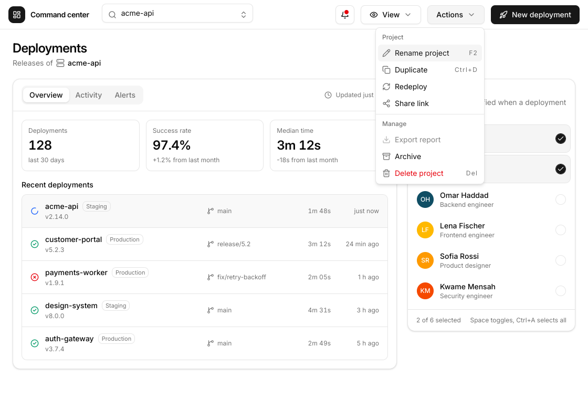
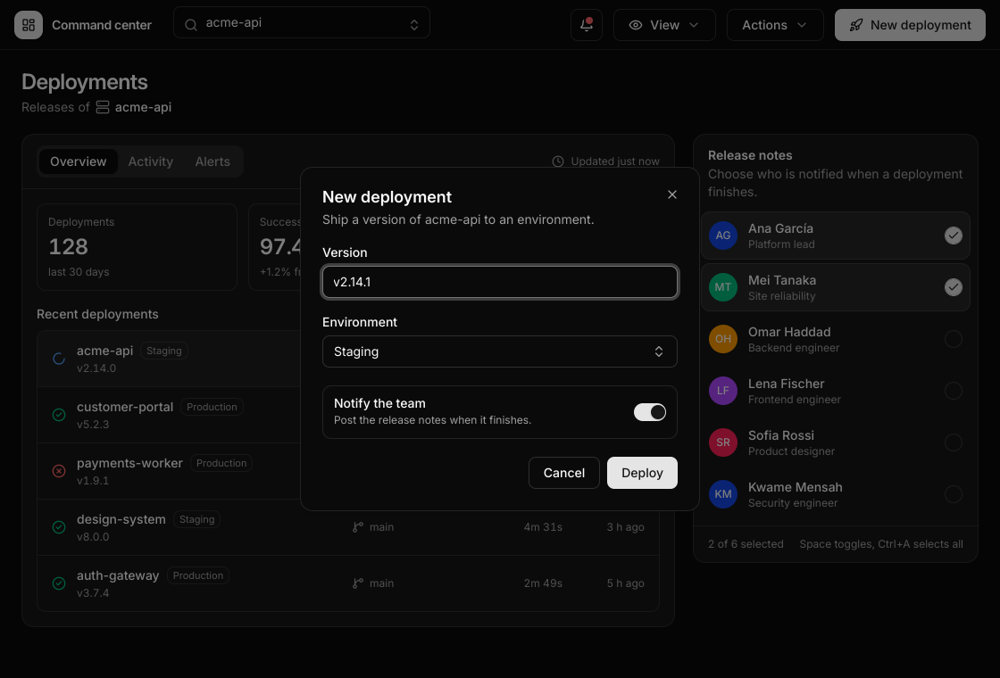
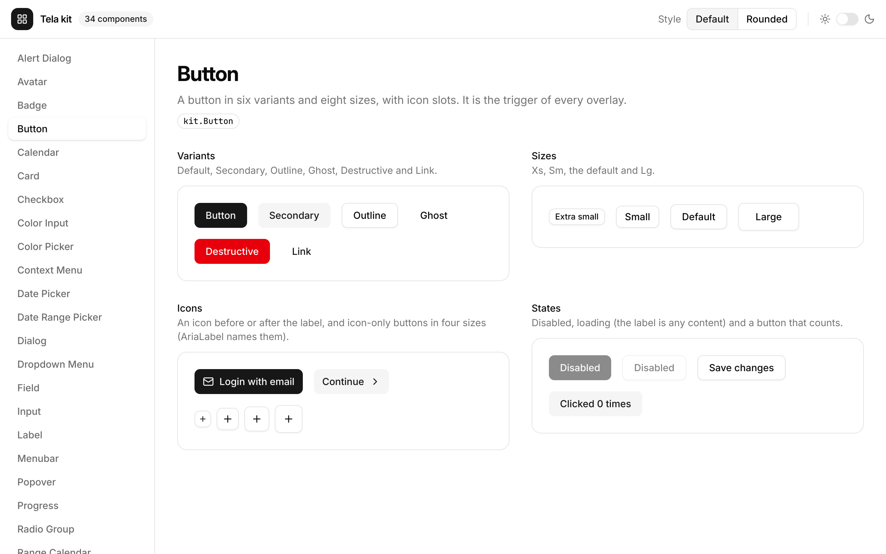
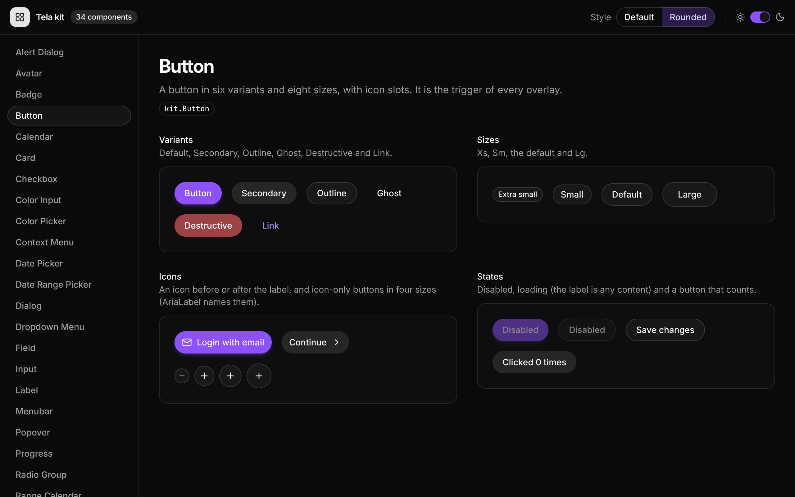

<h1 align="center">Tela</h1>

<p align="center">
  <a href="https://pkg.go.dev/github.com/kuronosu/tela"></a>
</p>

<p align="center">
  A desktop UI framework in <strong>pure Go</strong>.<br>
  No cgo, no webview, no native toolkits. Tailwind classes, React-style hooks.
</p>

<p align="center">
  
</p>

Tela draws every pixel itself, like Flutter or a browser, with its own
rasterizer, text layout and flexbox engine. You write components (structs with
a `Build` method, or functions) with hooks and style them with the Tailwind v4
vocabulary; the same tree renders to
a window on Linux or, with no window at all, to a PNG you can look at and a
text tree you can read. That last part is on purpose: Tela is designed so both
people and LLM agents can build good-looking interfaces without trial and
error.

> **Status: pre-1.0 (v0.10.0).** Phases 1–10 are done and tagged: Linux
> (Wayland, X11) and Windows windows, text inputs and IME, CSS grid,
> transitions and animations, glass effects, theme tokens, i18n, SVG icons,
> `aria` behavior hooks, `tela dev` (a reload that keeps your state) and
> `kit`, ready-made components you can restyle. macOS
> is not there yet. The public API (`tela`, `h`) may still break between minor
> versions. See [Project status](#project-status).

## Contents

- [Why Tela](#why-tela)
- [A first look](#a-first-look)
- [Quick start](#quick-start)
- [Examples](#examples)
- [Styling](#styling)
- [State and hooks](#state-and-hooks)
- [Components, icons and i18n](#components-icons-and-i18n)
- [Testing without a window](#testing-without-a-window)
- [Tooling for agents](#tooling-for-agents)
- [Project status](#project-status)
- [Documentation](#documentation)
- [Contributing](#contributing)
- [License](#license)

## Why Tela

- **Pure Go, always `CGO_ENABLED=0`.** Linux talks the Wayland and X11
  protocols over Unix sockets, Windows calls the system DLLs through
  `syscall`, and the macOS backend (planned) will use the Objective-C runtime
  without cgo. One `go build`,
  one static binary, easy cross-compilation.
- **Known vocabulary.** Names copy React (`UseState`, `UseEffect`, `Key`,
  `OnClick`) and classes copy Tailwind v4 verbatim. If an LLM would write it
  in React + Tailwind, it works here.
- **Real CSS semantics.** Block and flex layout checked against 828 Taffy
  fixtures and Chromium; box painting, gradients, shadows and blur compared to
  Chromium's pixels; text shaped with HarfBuzz (bidi, Arabic, CJK, color
  emoji). SVG icons are compared to Chromium too (Lucide's set, mean under
  one level per channel).
- **Deterministic.** Embedded fonts and an own rasterizer: same tree, same
  pixels on every platform and architecture. Goldens are bit-exact on amd64
  and arm64.
- **Fast when it matters, silent when it doesn't.** Frames on demand, 0% CPU
  when idle, layers with exact damage tracking, and phase-deferred values that
  repaint or relayout one element without rebuilding anything. A 100,000-row
  `VirtualList` scrolls with a p95 of 2.3 ms per frame on the CPU rasterizer.
- **Observable.** Everything renders headlessly and can be inspected as an
  aria snapshot or a layout tree. Errors teach:
  `unknown class "rounded-xxl"; did you mean "rounded-2xl"?`.
- **Fast to iterate.** `tela dev` rebuilds in the background and swaps the new
  build into the same window in about half a second, with your hook state,
  text, scroll and focus kept.

## A first look

```go
package main

import (
	"github.com/kuronosu/tela"
	. "github.com/kuronosu/tela/h"
)

// Counter is the public name; tela.C gives counter its own state and hooks.
func Counter() tela.Node { return tela.C(counter) }

func counter() tela.Node {
	count, setCount := tela.UseState(0)

	return Div(Class("flex flex-col items-center gap-6 p-10 rounded-3xl",
		"bg-linear-to-br from-indigo-500 to-fuchsia-600 shadow-2xl"),
		H1(Class("text-5xl font-bold text-white tracking-tight"),
			Textf("Count: %d", count)),
		Button(Class("px-6 py-3 rounded-xl bg-white/15 text-white backdrop-blur",
			"hover:bg-white/25 active:scale-95 transition"),
			OnClick(func() { setCount.Update(func(n int) int { return n + 1 }) }),
			Text("Increment"),
		),
	)
}

func main() {
	tela.Main(tela.App{Title: "Demo", Width: 800, Height: 600, Root: Counter()})
}
```

<p align="center">
  
</p>

This is [`examples/counter`](examples/counter), and it is the one that
anchors the project: its render matches the same markup written in HTML +
Tailwind CSS and drawn by Chromium 152, with every box edge within 0.01 px and
pixels equal except glyph antialiasing.

## Quick start

You need Go 1.27 or newer, and on Linux a Wayland or X11 session.

```bash
git clone https://github.com/kuronosu/tela
cd tela

# Open a window
CGO_ENABLED=0 go run ./examples/counter

# Or render without a window, to a PNG
CGO_ENABLED=0 go run ./cmd/tela snapshot --size 480x200 --scale 2 \
    -o counter.png ./examples/counter

# Print the screen as text (an aria snapshot, in YAML)
CGO_ENABLED=0 go run ./cmd/tela inspect --size 800x600 ./examples/counter

# Edit and save: the open window reloads with its state kept
CGO_ENABLED=0 go run ./cmd/tela dev ./examples/dashboard
```

The `inspect` output for the counter is what a screen reader, a test or an
agent sees:

```yaml
- 'heading "Count: 0" [level=1]'
- button "Increment"
```

> In your own project, install the command once instead of typing `go run
> github.com/kuronosu/tela/cmd/tela` every time:
> `CGO_ENABLED=0 go install github.com/kuronosu/tela/cmd/tela@latest`, then
> `tela new my-app` (a new app with a counter, a test and `go.mod` ready),
> `tela snapshot`, `tela inspect` and `tela dev`. It runs a package's own code,
> so it needs the `go` command and a package in a module that requires Tela
> (see [`cmd/tela`](cmd/tela) and the [CLI](docs/wiki/CLI.md) page).

> **Shipping on Windows:** build with
> `go build -trimpath -ldflags="-H=windowsgui"` so that double-clicking the
> app opens only its window, not a console next to it (see
> [Getting Started](docs/wiki/Getting-Started.md#ship-it)).

### Debug overlays

`TELA_DEBUG=layout,paint-flash,layers,fps,semantics` draws diagnostics on top
of a running app with Tela's own renderer, at no cost when off. Dev mode,
on in development builds and tests (`TELA_DEV=0` turns it off), reports
unknown classes, hook misuse with both call sites, and likely mistakes.

## Examples

Every screen lives in [`examples/`](examples), with its own README, goldens
and tests. They are the best way to see what the framework does today.

### Dashboard

A glassmorphism analytics dashboard built on `kit` with a glass recipe
(`kit.DefaultStyle()` edited and applied with `kit.StyleProvider`): CSS grid,
`sticky` and `fixed`, translucent panels with `backdrop-blur` over an image,
springs, layout animations (`AnimateLayout`, `LayoutID`), a `kit.Dialog`,
`kit.Toaster` toasts, `kit.Tabs`, `kit.ToggleGroup` and a light/dark switch. Its hand-made phase-6 version
ran at 60 fps at 1080p on CPU rendering (p95 of 14.6 ms per frame on 4 cores of
a Core Ultra 5); the kit version measured a 15% higher p95 than the old one on
the same machine (the benchmark and the "glass budget" are in its README).

<p align="center">
  
  
</p>

Dark mode is a class pair (`bg-white/55 dark:bg-white/5`) or, with the theme
tokens, a single class (`bg-background`); render it with `tela snapshot --dark`.

### Signup form

A "Create your account" screen on `kit`: `kit.Field` around `kit.Input` and
`kit.Textarea` with descriptions and errors (`aria-invalid`), a password with a
show/hide toggle and a strength `kit.Progress`, a live counter (`BindValue` +
`TextFn`), a `kit.Checkbox`, implicit submission with Enter, and a submit
button that stays disabled until the form is valid.

<p align="center">
  
</p>

### More screens

| | |
|---|---|
| **[pricing](examples/pricing)**: plans as `kit.Card`s, a monthly/yearly `kit.ToggleGroup`, `kit.Badge`s. <br> | **[settings](examples/settings)**: a whole form as one comparable value, `kit.Switch` rows, a `kit.RadioGroup` of theme cards, a Reset `kit.AlertDialog` and a toast on Save. <br> |
| **[player](examples/player)**: a `kit.Slider` seek bar that follows a playing clock and a drag without building anything (`Slider.ValueSource`), icon buttons with tooltips. <br> | **[board](examples/board)**: a kanban board with drag and drop between columns (`OnDrag`, `TranslateFn`), `kit.Card`s with a `kit.DropdownMenu` and a `kit.ContextMenu`, edit and delete dialogs. <br> |
| **[shapes](examples/shapes)**: rounded cards, gradients, analytic shadows, blur and glass. <br> | **[text](examples/text)**: mixed-script paragraphs (Latin, Arabic, CJK, emoji), selection and carets. <br> |

### Command center (`aria`)

**[aria](examples/aria)**: a shadcn/ui-style screen built only from the
behavior hooks of package `aria`, `h` elements and theme-token classes, with
no hand-written key handling: a project combobox, a tooltip, two menus, a
modal dialog with a form, tabs and a multiple-selection list box, with
entrance and exit animations. Its tests drive the menu, the combobox and the
dialog with the keyboard alone.

<p align="center">
  
  
</p>

### Component gallery (`kit`)

**[kit](examples/kit)**: the gallery of package `kit`, shadcn/ui's look as
Go components: a sidebar with 34 components and a page for each with its
variants, sizes and states in a small realistic composition, a light/dark switch
and a Style picker that restyles the whole window with a second recipe made of a
few edits of `kit.DefaultStyle()`. Everything on screen is a kit component. Every
page is also a preview (`tela dev --preview Calendar ./examples/kit`), and its
tests drive the sidebar with the keyboard alone.

<p align="center">
  
  
</p>

### Native look

**[native](examples/native)**: one file-explorer tree that looks native on
Windows 11, GNOME and KDE, each in light and dark. A theme is a set of class
strings (`bg-[#cce8ff]`, `rounded-[8px]`), a column order and some number
formats; `-theme=` and `-dark=` choose the look, and `-dark=auto` follows the
system.

<p align="center">
  
  
  
</p>

Also there: [`hello`](examples/hello), the screen at the top of this page;
[`virtuallist`](examples/virtuallist), 100,000 people in one
`h.VirtualList` with variable row heights and `ScrollToIndex`;
[`motion`](examples/motion), a dialog, a toast and a draggable card with
springs; [`layout`](examples/layout), a reorderable list, an expanding
card and a sliding tab underline with layout animations; and
[`i18n`](examples/i18n), an order summary in English, Spanish and Arabic that
switches language while running and mirrors to right to left.

## Styling

Classes are Tailwind v4's, generated from its theme and parsed into a typed
`ComputedStyle`: spacing, sizing, colors with `/NN` opacity, borders, radius,
shadows, gradients, typography, flex, grid, `relative`/`absolute`/`fixed`/
`sticky` positioning, overflow, transforms, filters and `backdrop-blur-*`,
`mix-blend-*`, `[clip-path:…]`, background images (`bg-[url(…)]` from files
registered with `tela.Assets`), `bg-clip-text`, transitions (`transition`,
`duration-*`, `ease-*`, `delay-*`), `animate-*`, arbitrary values
(`w-[calc(50%-8px)]`) and variants (`hover:`, `active:`, `focus:`,
`focus-visible:`, `disabled:`, `group-*`, `peer-*`, `dark:`, `motion-reduce:`,
`starting:`, `aria-*`, `rtl:`, `md:`/`max-md:`/`min-[600px]:`), CSS masks
(`mask-[url(…)]`, gradient masks), SVG paints (`fill-*`, `stroke-*`) and
logical utilities for right-to-left layout (`ms-`, `pe-`, `border-s`).
shadcn/ui's theme tokens (`bg-primary`, `text-muted-foreground`,
`border-border`) follow the light/dark scheme without `dark:` pairs and are
set with `App.Theme`. Typed helpers cover what a class cannot, such as values
that change every frame.

## State and hooks

`UseState`, `UseReducer`, `UseEffect`, `UseLayoutEffect`, `UseMemo`,
`UseCallback`, `UseRef`, `UseContext`, `UseID`, `UseMount`, `UseOnce`,
`UseInterval`, `UseTimeout`, `UseGo`, plus `tela.UseValue` for
values that should repaint or relayout one element without rebuilding the
component that owns them. Component boundaries `tela.C`, `tela.CP` and
`tela.Memo` skip work when props are comparable and equal.

Animation builds on the same values: `tela.UseSpring`, `tela.UseTween` and
`tela.Animate` move a `Value` without rebuilding (`Velocity`, `OnDone` and
other options), `h.Presence` with `starting:` classes and `h.Exit` animates
enter and exit, and `h.AnimateLayout()` / `h.LayoutID(id)` animate layout
changes and shared elements, Motion style. `tela.UseColorScheme` and
`tela.SetColorScheme` read and switch light and dark.

```go
type Row struct{ Index int }

func (r Row) Build() tela.Node { /* ... */ }

// Only rows that enter the viewport are built; a scroll that stays inside the
// built rows only repaints.
VirtualList(100_000, func(int) float32 { return 65 }, func(i int) tela.Component {
	return Row{Index: i}
})
```

## Components, icons and i18n

- **`aria`**: behavior hooks in React Aria's model, with no look of their own:
  `UsePress`, `UseHover`, `UseFocusRing`, `UseFocusScope`, `UseButton`,
  `UseCheckbox`, `UseSwitch`, overlays (`UseOverlay`, `UseDialog`,
  `UsePopover`, tooltips, menu triggers), collections (`UseListBox`,
  `UseMenu`, `UseTabs`, `UseSelect`, `UseCombobox`) and `UseFloating`, a port
  of Floating UI's positioning. Each returns a `Props` value to spread on any
  element, so you style it with plain classes.
- **`kit`**: 34 ready-made components in the look of shadcn/ui (button, card,
  input, field, select, tabs, table, dialog, popover, tooltip, toasts, menus,
  checkbox, switch, radio group, slider, calendar, date picker, color picker...),
  built on `aria` and the theme tokens. Struct components with slots, one value
  rule (`Value *T`, `DefaultValue`, `OnValueChange`), and a look that is data:
  edit `kit.DefaultStyle()` and apply it to a subtree with `kit.StyleProvider`.
  The [`examples/kit`](examples/kit) gallery shows them all; the guide is
  [Kit](https://github.com/kuronosu/tela/wiki/Kit) on the wiki. (Phase 10.)
- **Icons and images**: `h.Icon` draws SVG as vectors, colored by the text
  color; `Img` takes files, `embed.FS`, bytes and SVG, with `h.Tint`. The
  separate module `github.com/kuronosu/tela/icons/lucide` has Lucide's whole
  set (`h.Icon(lucide.Check, Class("size-4"))`), and `tela icons gen` makes
  the same kind of package from your own SVG files; the linker drops the icons
  a program does not use.
- **`tela/i18n`**: JSON catalogs with ICU MessageFormat (plurals, select),
  locale-aware numbers, dates and lists, runtime switching, and right-to-left
  layout with `h.Dir`.

## Testing without a window

`telatest` mounts a component with no window, simulates input and compares
pixels or semantics. It finds elements the way an assistive technology does:

```go
func TestIncrement(t *testing.T) {
	app := telatest.Mount(t, Counter(), telatest.Size(800, 600))

	app.Click(telatest.ByRole("button", "Increment"))

	app.ExpectAria(`
		- 'heading "Count: 1" [level=1]'
		- button "Increment"
	`)
	app.Golden("counter_clicked.png")
}
```

Regenerate goldens with `TELA_UPDATE=1 CGO_ENABLED=0 go test ./...` and review
the diff.

## Tooling for agents

Because the whole pipeline is headless, a loop of *write → `tela snapshot` →
look at the PNG → `tela inspect` → fix* needs no window and no human. Unknown
classes come with suggestions, and `tela inspect --layout` prints boxes as
JSON. For people, `tela dev ./yourapp` reloads the open window on every save in
about half a second, keeping its state: hooks, text fields, scroll and focus
(see the [CLI](docs/wiki/CLI.md#tela-dev) page). Planned: `tela lint`,
`tela mcp` and a `docs/llms.txt` (phase 11).

## Project status

**Current version: [v0.10.0](CHANGELOG.md)**, tagged 2026-10-25. Phases 1–10
are done.

| Phase | Name | State |
|---|---|---|
| 1 | Pixels on screen: rasterizer, shadows, blur, Wayland and X11 windows | ✅ v0.1.0 |
| 2 | Text: shaping, bidi, Parley-style layout, selection, emoji | ✅ v0.2.0 |
| 3 | Tree, style, layout: reconciler, Tailwind classes, flex, `tela snapshot` | ✅ v0.3.0 |
| 4 | Interaction and state: hooks, pointer and keyboard, focus, scrolling, `VirtualList`, `telatest` | ✅ v0.4.0 |
| 5 | Windows and text editing: `win32`, `Input`/`Textarea`, IME, inline decorations | ✅ v0.5.0 |
| 6 | Advanced CSS and animation: grid, `fixed`/`sticky`, transitions, springs, layout animations, blend modes, clip-path, background images, fractional scaling | ✅ v0.6.0 |
| 7 | Public API polish: struct components, theme tokens, `tela/i18n`, right-to-left, dev mode by default | ✅ v0.7.0 |
| 8 | Icons, SVG and `aria`: `h.Icon`, Lucide, `tela icons gen`, behavior hooks, `UseFloating` | ✅ v0.8.0 |
| 9 | Dev loop: `tela dev`, a reload that keeps state | ✅ v0.9.0 |
| 10 | `kit`: ready-made components on the theme tokens, restyled with recipes | ✅ v0.10.0 |
| 11 | `tela lint`, `tela mcp`, `llms.txt`, full-screen examples | next |
| 12 | Desktop essentials: window control, multiple windows, native dialogs, tray and notifications, app data | planned |
| 13 | Desktop integration: drag and drop with the OS, native menus, global shortcuts, deep links, secure storage | planned |
| 14 | macOS and IME on X11 | planned |
| 15–20 | Accessibility backends, GPU backend, packaging and auto-update, DevTools, canvas and PDF, audio and video | planned |

### What works today

| | Linux Wayland | Linux X11 | Headless | Windows | macOS |
|---|---|---|---|---|---|
| Window and rendering | ✅ | ✅ | ✅ | ✅ | cross-compiles, no backend yet |
| Pointer, scroll, keyboard | ✅ | ✅ | ✅ (`telatest`) | ✅ | — |
| Text fields, clipboard | ✅ | ✅ | ✅ (`telatest`) | ✅ | — |
| IME (Japanese, Chinese, …) | ✅ (`text-input-v3`) | — (phase 14) | ✅ (injected) | ✅ (IMM32) | — |

Implemented: block, flex and grid layout with relative, absolute, fixed and
sticky positioning; Tailwind classes and variants; shaped text with fallback;
gradients, shadows, blur and backdrop blur, blend modes, clip paths,
background images, transforms and opacity layers; CSS transitions and
`animate-*`; springs, tweens, enter/exit and layout animations; portals;
light/dark switching and theme tokens; right-to-left layout; i18n; fractional
scaling on Wayland; hooks; pointer events with a gesture arena (tap, drag,
long-press); focus and Tab order; scrolling with kinetic touchpad support;
`VirtualList`; text fields (`Input`, `Textarea`) with selection, undo,
clipboard and IME, `Form` and `Label`; inline decorations in paragraphs; a
semantics tree; SVG icons, images and masks; the `aria` behavior hooks; debug
overlays; the `tela` CLI (`snapshot`, `inspect`, `dev`, `icons gen`).

### Not yet, or known limits

- **No macOS window** yet (phase 14); it cross-compiles. No IME on X11 yet
  (XIM, phase 14).
- **Glass pages at 2x are not 60 fps while scrolling** on CPU (the phase-6
  dashboard's p95 was 36–48 ms per frame at 2880×1800 and 4K, 14.6 ms at 1080p).
- Transforms are 2D only; SVG has no text, filters or patterns; no
  `grid-template-areas` from classes; menus have no submenus yet.
- `tela dev` has not been run on macOS; an IME composition is lost across a
  reload, and a renamed component starts fresh.
- No accessibility backend (AT-SPI, UIA, NSAccessibility) yet.

The full list of limitations is in [`docs/ROADMAP.md`](docs/ROADMAP.md).

## Documentation

- **API reference on pkg.go.dev**, one page per public package:
  [`tela`](https://pkg.go.dev/github.com/kuronosu/tela) (app, hooks, events,
  style props),
  [`h`](https://pkg.go.dev/github.com/kuronosu/tela/h) (elements, props,
  helpers) and
  [`telatest`](https://pkg.go.dev/github.com/kuronosu/tela/telatest) (tests
  without a window).
- **Guides on the [wiki](https://github.com/kuronosu/tela/wiki)**: getting
  started, styling, theming, hooks, animation, events, forms, scrolling,
  `aria`, `kit`, icons, internationalization, accessibility, testing and the CLI,
  with a working example each. Its sources are versioned in
  [`docs/wiki`](docs/wiki); the API reference pages there are generated from
  the doc comments with `go generate`.

| Document | What it is |
|---|---|
| [`docs/ARCHITECTURE.md`](docs/ARCHITECTURE.md) | The design: layers, trees, pipeline, layout, text, input, platform layer |
| [`docs/adr/`](docs/adr/README.md) | The decision log: one file per ADR, with an index |
| [`docs/ROADMAP.md`](docs/ROADMAP.md) | Current status, open limitations, next step and the phases left |
| [`docs/HISTORY.md`](docs/HISTORY.md) | Finished phases, past status notes and the session log |
| [`CHANGELOG.md`](CHANGELOG.md) | User-visible changes per version |
| [`THIRD_PARTY.md`](THIRD_PARTY.md) | Ported code and third-party licenses |
| `examples/*/README.md` | What each example demonstrates |

## Contributing

Tela is developed in the open but is young; the design is settled in
`docs/ARCHITECTURE.md` and changes to it go through an ADR. Please read
[`AGENTS.md`](AGENTS.md) first. The hard rules are:

- Never cgo. Everything runs with `CGO_ENABLED=0` (the race detector is the
  only verification-only exception).
- Pure-Go, permissively licensed dependencies from the approved list only.
- Everything in English: code, comments, commits and docs.
- Visual changes come with headless goldens; look at the snapshot.

```bash
CGO_ENABLED=0 go build ./...
CGO_ENABLED=0 go vet ./...
CGO_ENABLED=0 staticcheck ./...
CGO_ENABLED=0 go test ./...

# Cross-compilation must always build
CGO_ENABLED=0 GOOS=windows go build ./...
CGO_ENABLED=0 GOOS=darwin  go build ./...
```

## License

Tela is released under the [BSD 3-Clause License](LICENSE). Third-party code
and the embedded fonts keep their own licenses; see
[`THIRD_PARTY.md`](THIRD_PARTY.md).
