<p align="center">
  <picture>
    <source media="(prefers-color-scheme: dark)" srcset="site/src/assets/brand/tela-lockup-dark.svg">
    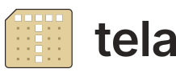
  </picture>
</p>

<p align="center">
  <a href="https://pkg.go.dev/github.com/kuronosu/tela"></a>
</p>

<p align="center">
  A desktop UI framework in <strong>pure Go</strong>.<br>
  No cgo, no webview, no native toolkits. Tailwind classes, React-style hooks.
</p>

<p align="center">
  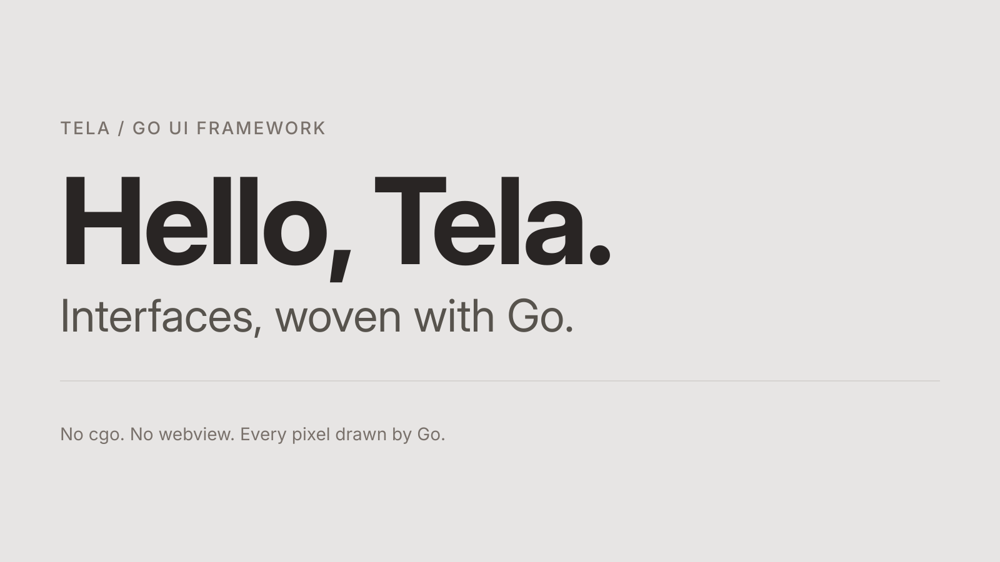
</p>

Tela draws every pixel itself, like Flutter or a browser, with its own
rasterizer, text layout and flexbox engine. You write components (structs with
a `Build` method, or functions) with hooks and style them with the Tailwind v4
vocabulary; the same tree renders to
a window on Linux or, with no window at all, to a PNG you can look at and a
text tree you can read. That last part is on purpose: Tela is designed so both
people and LLM agents can build good-looking interfaces without trial and
error.

> **Status: pre-1.0 (v0.14.3).** Phases 1–23 are done and tagged: Linux
> (Wayland, X11), Windows and macOS windows, text inputs and IME, CSS grid,
> transitions and animations, glass effects, theme tokens, i18n, SVG icons,
> `aria` behavior hooks, `tela dev` (a reload that keeps your state) and
> `kit`, ready-made components you can restyle, and screen readers on all
> three systems, and transparent windows. macOS (13 or later) is
> verified on CI and has not yet been tried on a real Mac. The public API (`tela`, `h`) may still break between minor
> versions. See [Project status](#project-status).

## Contents

- [Why Tela](#why-tela)
- [A first look](#a-first-look)
- [Quick start](#quick-start)
- [Examples](#examples)
- [Styling](#styling)
- [State and hooks](#state-and-hooks)
- [Components, icons and i18n](#components-icons-and-i18n)
- [Testing without a window](#testing-without-a-window)
- [Tooling for agents](#tooling-for-agents)
- [Project status](#project-status)
- [Documentation](#documentation)
- [Contributing](#contributing)
- [License](#license)

## Why Tela

- **Pure Go, always `CGO_ENABLED=0`.** Linux talks the Wayland and X11
  protocols over Unix sockets, Windows calls the system DLLs through
  `syscall`, and macOS calls AppKit through the Objective-C runtime
  (purego), without cgo. One `go build`,
  one static binary, easy cross-compilation.
- **Known vocabulary.** Names copy React (`UseState`, `UseEffect`, `Key`,
  `OnClick`) and classes copy Tailwind v4 verbatim. If an LLM would write it
  in React + Tailwind, it works here.
- **Real CSS semantics.** Block, flex and grid layout checked against about
  1,400 Taffy fixtures and Chromium; box painting, gradients, shadows and
  blur compared to Chromium's pixels; text shaped with HarfBuzz (bidi,
  Arabic, CJK, color emoji). SVG icons are compared to Chromium too
  (Lucide's set, mean under one level per channel).
- **Deterministic.** Tela's own rasterizer, and fonts that tests and
  snapshots bring themselves: same tree, same pixels on every platform and
  architecture. Goldens are bit-exact on amd64 and arm64. An app uses the
  system's fonts, or embeds the ones it wants (`Fonts: []tela.Font{inter.Sans}`)
  and pays for them in its binary only then.
- **Fast when it matters, silent when it doesn't.** Frames on demand, 0% CPU
  when idle, layers with exact damage tracking, and phase-deferred values that
  repaint or relayout one element without rebuilding anything. A 100,000-row
  `VirtualList` scrolls with a p95 of 2.3 ms per frame on the CPU rasterizer.
- **Observable.** Everything renders headlessly and can be inspected as an
  aria snapshot or a layout tree. Errors teach:
  `unknown class "rounded-xxl"; did you mean "rounded-2xl"?`.
- **Fast to iterate.** `tela dev` rebuilds in the background and swaps the new
  build into the same window in about half a second, with your hook state,
  text, scroll and focus kept.

## A first look

```go
package main

import (
	"github.com/kuronosu/tela"
	. "github.com/kuronosu/tela/h"
)

// Counter is the public name; tela.C gives counter its own state and hooks.
func Counter() tela.Node { return tela.C(counter) }

func counter() tela.Node {
	count, setCount := tela.UseState(0)

	return Div(Class("flex items-center justify-center h-full bg-stone-200"),
		Div(Class("flex flex-col items-center gap-6 w-80 p-10 rounded-2xl",
			"bg-stone-50 border border-stone-300 shadow-xl text-stone-800"),
			Span(Class("text-sm font-medium tracking-widest text-stone-500"), Text("COUNT")),
			H1(Class("text-8xl font-bold tracking-tight tabular-nums"), Textf("%d", count)),
			Button(Class("w-full py-3 rounded-xl bg-stone-800 text-stone-100 font-medium",
				"hover:bg-stone-700 active:scale-95 transition"),
				OnClick(func() { setCount.Update(func(n int) int { return n + 1 }) }),
				Text("Increment"),
			),
		),
	)
}

func main() {
	tela.Main(tela.App{Title: "Demo", Width: 800, Height: 600, Root: Counter()})
}
```

<p align="center">
  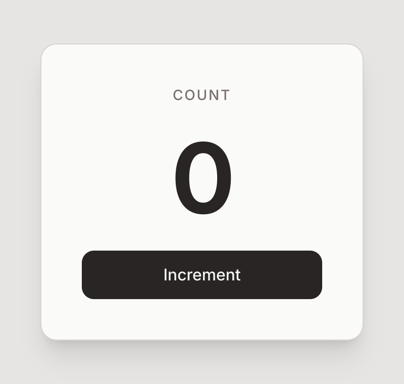
</p>

This is [`examples/counter`](examples/counter), and it is the one that
anchors the project: its render matches the same markup written in HTML +
Tailwind CSS and drawn by Chromium 152, with every box edge within 0.02 px and
pixels equal except glyph antialiasing.

## Quick start

You need Go 1.27 or newer, and on Linux a Wayland or X11 session.

```bash
git clone https://github.com/kuronosu/tela
cd tela

# Open a window
CGO_ENABLED=0 go run ./examples/counter

# Or render without a window, to a PNG
CGO_ENABLED=0 go run ./cmd/tela snapshot --size 400x380 --scale 2 \
    -o counter.png ./examples/counter

# Print the screen as text (an aria snapshot, in YAML)
CGO_ENABLED=0 go run ./cmd/tela inspect --size 800x600 ./examples/counter

# Edit and save: the open window reloads with its state kept
CGO_ENABLED=0 go run ./cmd/tela dev ./examples/dashboard
```

The `inspect` output for the counter is what a screen reader, a test or an
agent sees:

```yaml
- text: COUNT
- heading "0" [level=1]
- button "Increment"
```

> In your own project, install the command once instead of typing `go run
> github.com/kuronosu/tela/cmd/tela` every time:
> `CGO_ENABLED=0 go install github.com/kuronosu/tela/cmd/tela@latest`, then
> `tela new my-app` (a new app with a counter, a test and `go.mod` ready),
> `tela snapshot`, `tela inspect` and `tela dev`. It runs a package's own code,
> so it needs the `go` command and a package in a module that requires Tela
> (see [`cmd/tela`](cmd/tela) and the [CLI](docs/wiki/CLI.md) page).

> **Shipping on Windows:** build with
> `go build -trimpath -ldflags="-H=windowsgui"` so that double-clicking the
> app opens only its window, not a console next to it (see
> [Getting Started](docs/wiki/Getting-Started.md#ship-it)).

### Debug overlays

`TELA_DEBUG=layout,paint-flash,layers,fps,semantics` draws diagnostics on top
of a running app with Tela's own renderer, at no cost when off. Dev mode,
on in development builds and tests (`TELA_DEV=0` turns it off), reports
unknown classes, hook misuse with both call sites, and likely mistakes.

## Examples

Every screen lives in [`examples/`](examples), with its own README, goldens
and tests. They are the best way to see what the framework does today.

### Dashboard

"Frosted graphite": an analytics dashboard, dark first, with three fixed
panes of real glass (`backdrop-blur-2xl`) over a dune wallpaper and one amber
accent. An overview with metric tabs, a spectrum of 48 bars and figures that
follow springs without building (`UseSpring` with `TextFn` and `HeightFn`);
tasks as a sortable `kit.Table` (a finished task slides to the end with
`AnimateLayout`) or as a board whose cards are dragged between columns
(`OnDrag`, `TranslateFn`) and moved, edited or deleted from a
`kit.DropdownMenu`, a `kit.ContextMenu` and dialogs; 240 orders in a filtered
table; a command palette (Ctrl+K) and tooltips built directly on `aria` hooks
(`UseOverlay`, `UseDialog`, `UseCombobox`, `UseTooltipTrigger`,
`UseFloating`); `LayoutID` pills, toasts and a theme switch. It is the screen
of the GPU backend's criterion: the CPU rasterizer does not draw it
at 60 fps at scale 2. Its benchmarks and its "glass budget" are in its README.

<p align="center">
  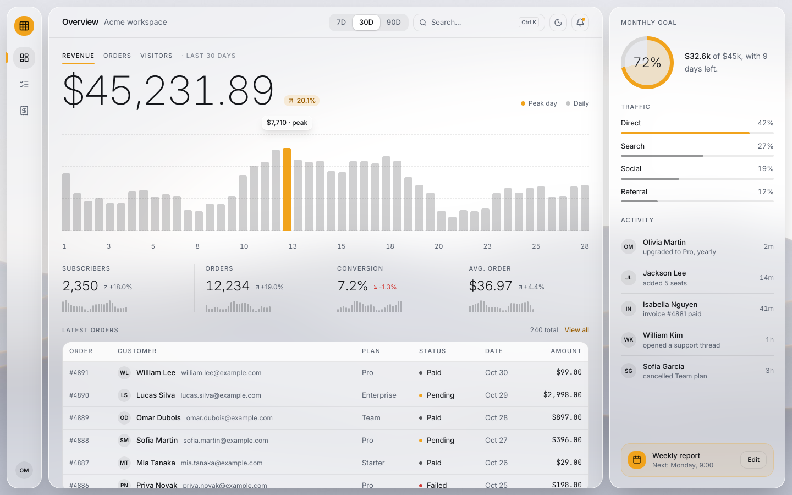
  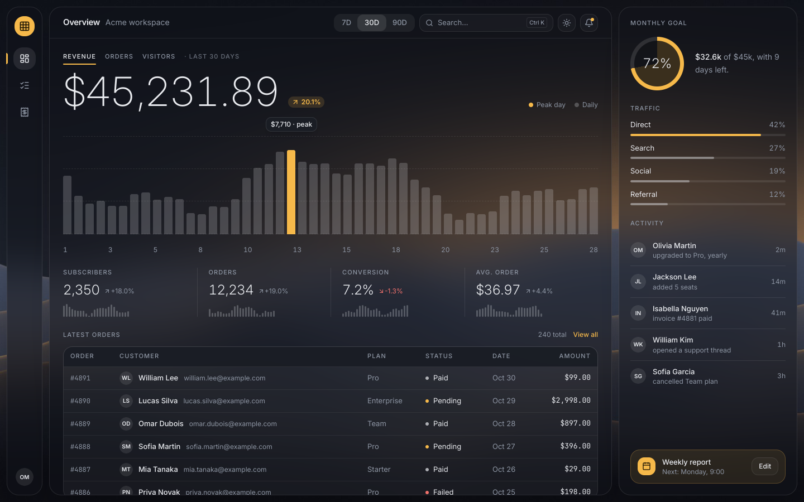
</p>

Dark mode is a class pair (`bg-white/55 dark:bg-white/5`) or, with the theme
tokens, a single class (`bg-background`); render it with `tela snapshot --dark`.

### More screens

| | |
|---|---|
| **[settings](examples/settings)**: Darkroom's Preferences, a photo editor's window with five sections, built by an LLM from `llms.txt` and a prompt: a whole form as one comparable value, validation that blocks Save, confirmations, and a theme and accent applied on Save. <br>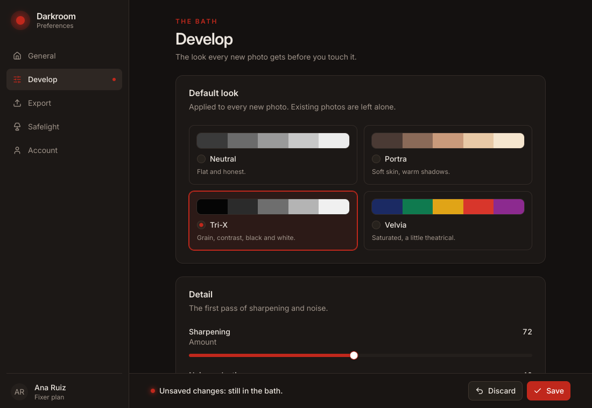 | **[player](examples/player)**: a `kit.Slider` seek bar that follows a playing clock and a drag without building anything (`Slider.ValueSource`), icon buttons with tooltips. <br>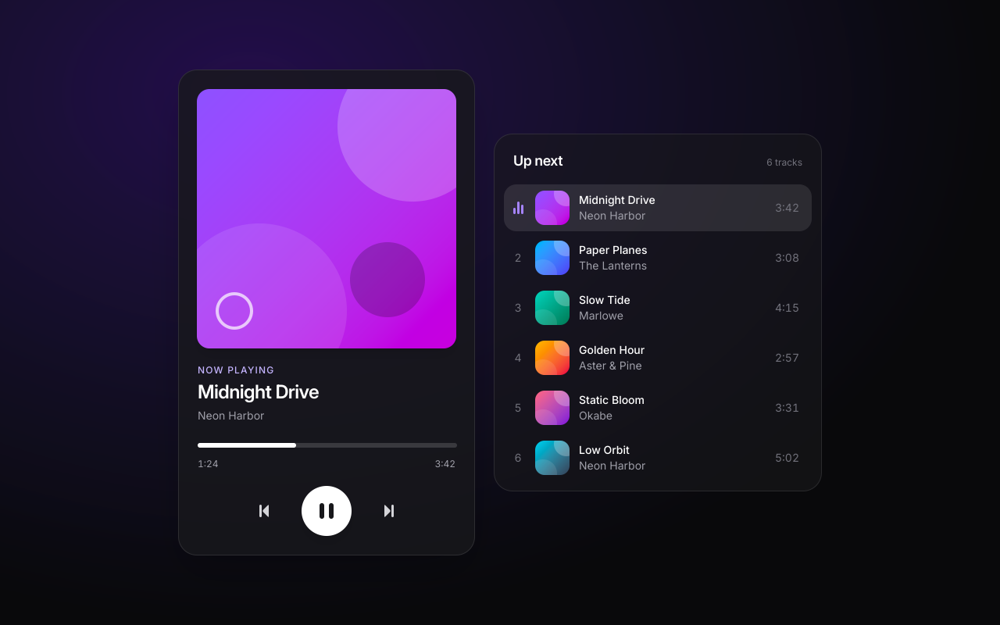 |
| **[login](examples/login)**: a card with a brand panel that hides below `md:` and two modes, Sign in and Create account: `kit.Field` around every control with errors (`aria-invalid`), a show/hide password button, a strength `kit.Progress`, a bio with a live counter (`BindValue` + `TextFn`), a spinner while a fake request runs on `tela.UseTimeout`, an alert for a wrong password. <br>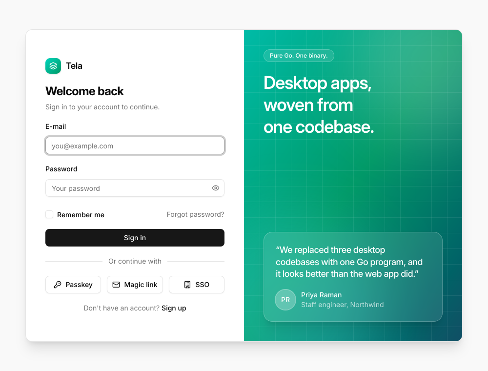 | **[chat](examples/chat)**: a messaging app on `kit`: one reducer for the whole state, `tela.UseTimeout` for the typing indicator and the reply, `h.AriaCurrent` on the open conversation, a virtualized message list that scrolls to its end, a growing `kit.Textarea` composer. <br>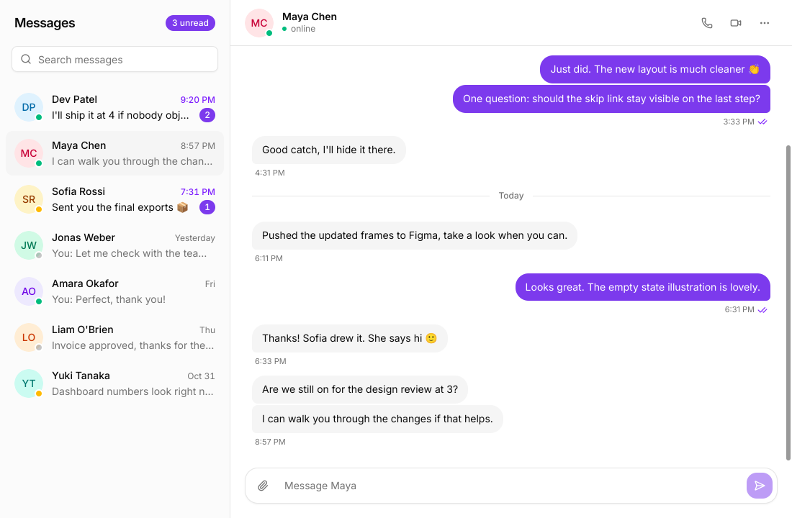 |
| **[notes](examples/notes)**: the desktop services of package `desktop` in a small notes app: native open and save dialogs, a tray icon with a menu, a second window (Preferences) with settings stored by `desktop.UseSetting`, a remembered window position, a message box before quitting, a notification after saving, and its own `kit.TitleBar` under the OS's window buttons (`TitleBarOverlay`: the traffic lights on macOS, where it also has an app menu bar and `OnQuit`). <br>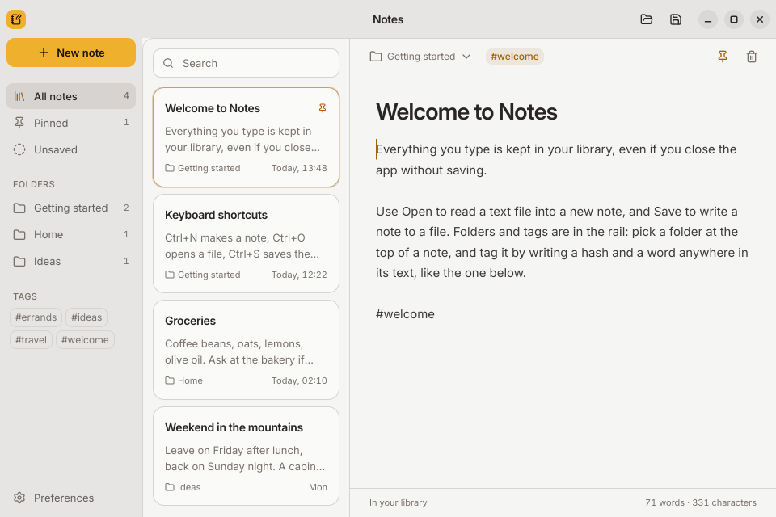 | |

### Component gallery (`kit`)

**[kit](examples/kit)**: the gallery of package `kit`, shadcn/ui's look as
Go components: it opens on an Introduction, with a sidebar and a page for each of
its 37 components, each with its variants, sizes and states in a small realistic
composition, a light/dark switch and a Style picker that restyles the whole window
with a second recipe made of a few edits of `kit.DefaultStyle()`. A Language menu
(English, Spanish, Arabic) sets the language and the direction of the whole window,
so every page can be seen right to left, and an Internationalization page shows
the catalogs, plurals and formats behind it
(`tela dev --preview Internationalization ./examples/kit`). Everything on screen is
a kit component. Every page is also a preview (`tela dev --preview Calendar
./examples/kit`), and its tests drive the sidebar with the keyboard alone.

<p align="center">
  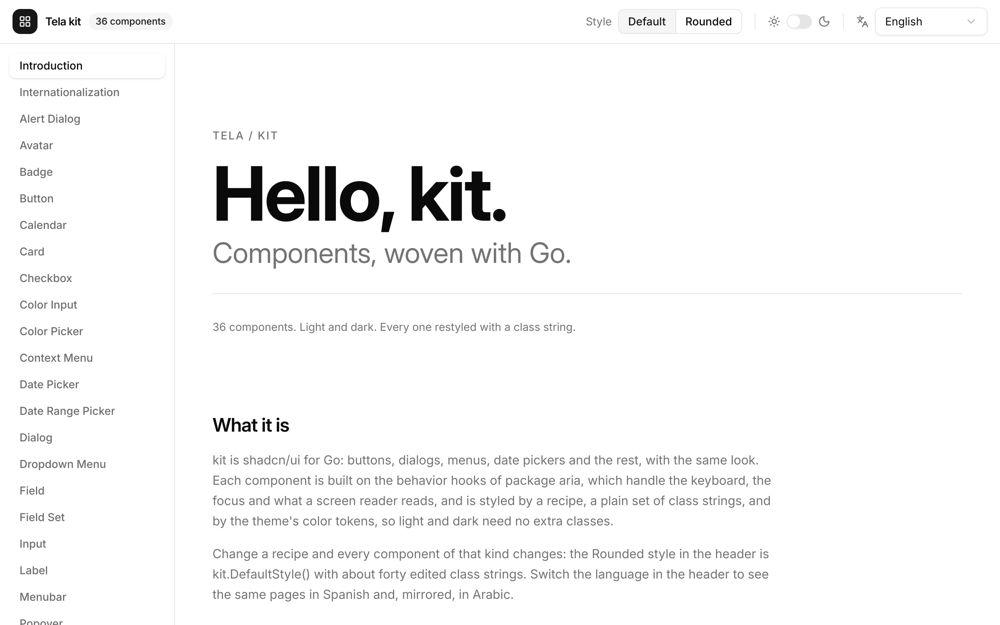
  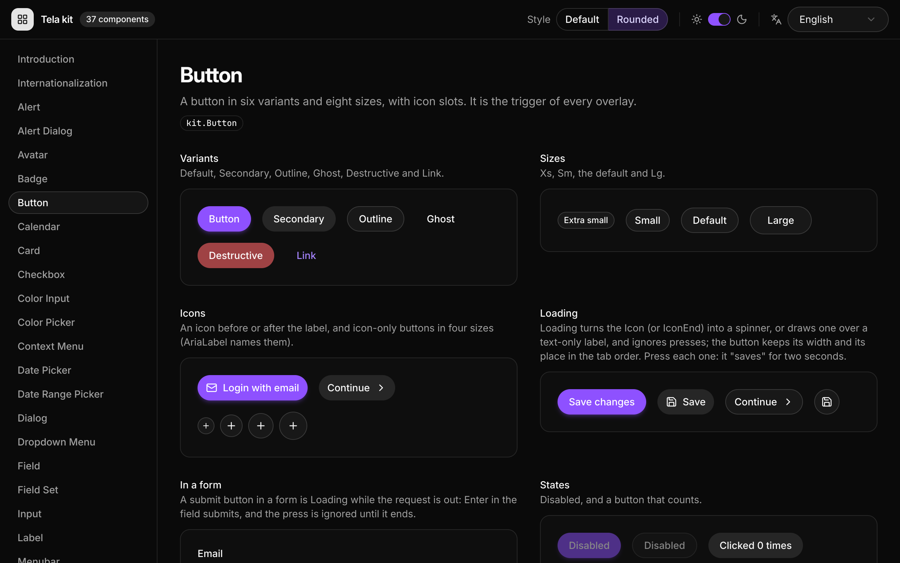
</p>

### Platform looks

**[looks](looks)** is a separate module, `github.com/kuronosu/tela/looks`
(ADR-197), with the looks of Windows 11, GNOME, KDE and macOS (Tahoe and
Sequoia, which an app can mix per part; ADR-223), each in light and dark. A look is a `tela.Theme` (the tokens), a `kit.Style` (the recipes of the
controls) and `Regions` (the classes of the toolbar, sidebar, content, details
pane and status bar); `win11.Look()`, `adwaita.Look()`, `breeze.Look()`,
`aqua.Look()` and `detect.Look()` (the look of the running desktop) return one. Its
[gallery](looks/gallery) shows kit's controls in each look and switches between
them while it runs (`cd looks && go run ./gallery -look=breeze -dark=true`).

<p align="center">
  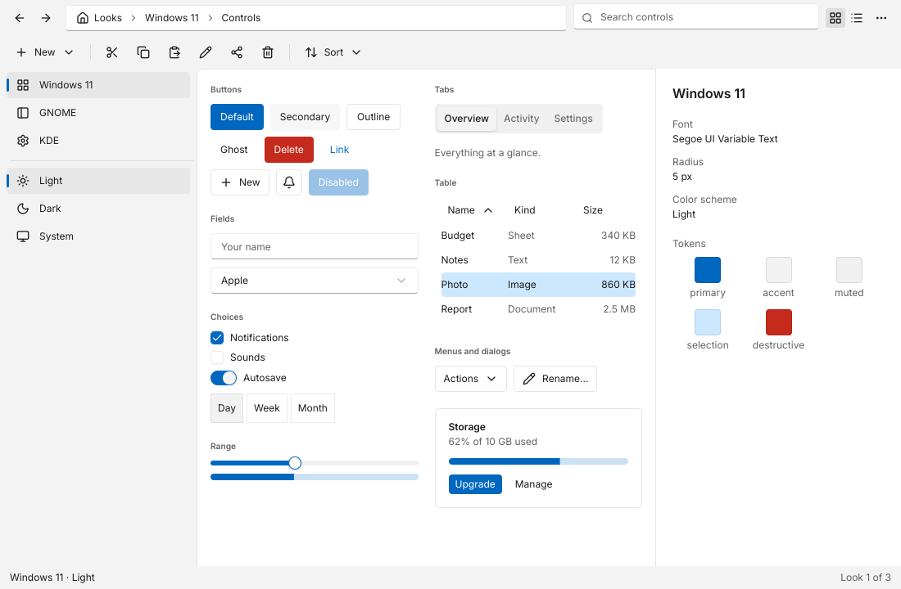
  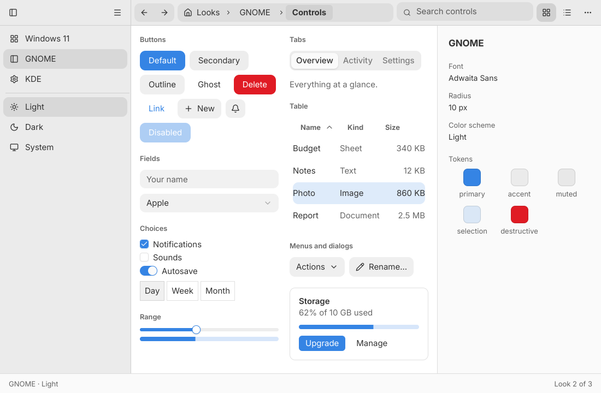
  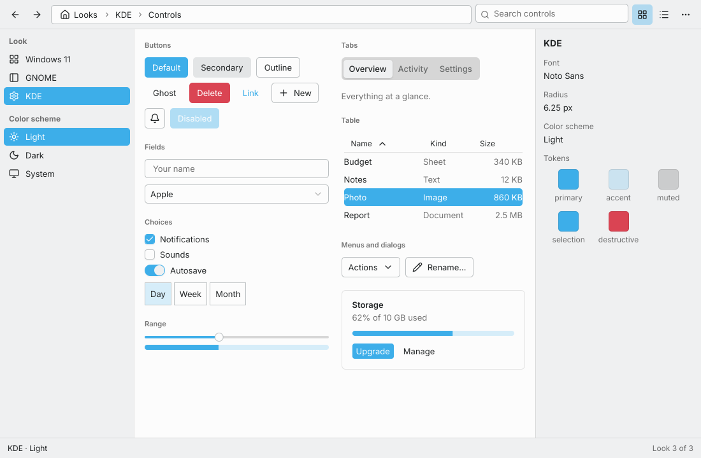
</p>

Also there: [`hello`](examples/hello), the screen at the top of this page.

## Styling

Classes are Tailwind v4's, generated from its theme and parsed into a typed
`ComputedStyle`: spacing, sizing, colors with `/NN` opacity, borders, radius,
shadows, gradients, typography, flex, grid, `relative`/`absolute`/`fixed`/
`sticky` positioning, overflow, transforms, filters and `backdrop-blur-*`,
`mix-blend-*`, `[clip-path:…]`, background images (`bg-[url(…)]` from files
registered with `tela.Assets`), `bg-clip-text`, transitions (`transition`,
`duration-*`, `ease-*`, `delay-*`), `animate-*`, arbitrary values
(`w-[calc(50%-8px)]`) and variants (`hover:`, `active:`, `focus:`,
`focus-visible:`, `disabled:`, `group-*`, `peer-*`, `dark:`, `motion-reduce:`,
`starting:`, `aria-*`, `rtl:`, `md:`/`max-md:`/`min-[600px]:`), CSS masks
(`mask-[url(…)]`, gradient masks), SVG paints (`fill-*`, `stroke-*`) and
logical utilities for right-to-left layout (`ms-`, `pe-`, `border-s`).
shadcn/ui's theme tokens (`bg-primary`, `text-muted-foreground`,
`border-border`) follow the light/dark scheme without `dark:` pairs and are
set with `App.Theme`. Typed helpers cover what a class cannot, such as values
that change every frame.

## State and hooks

`UseState`, `UseReducer`, `UseEffect`, `UseLayoutEffect`, `UseMemo`,
`UseCallback`, `UseRef`, `UseContext`, `UseID`, `UseMount`, `UseOnce`,
`UseInterval`, `UseTimeout`, `UseGo`, plus `tela.UseValue` for
values that should repaint or relayout one element without rebuilding the
component that owns them. Component boundaries `tela.C`, `tela.CP` and
`tela.Memo` skip work when props are comparable and equal.

Animation builds on the same values: `tela.UseSpring`, `tela.UseTween` and
`tela.Animate` move a `Value` without rebuilding (`Velocity`, `OnDone` and
other options), `h.Presence` with `starting:` classes and `h.Exit` animates
enter and exit, and `h.AnimateLayout()` / `h.LayoutID(id)` animate layout
changes and shared elements, Motion style. `tela.UseColorScheme` and
`tela.SetColorScheme` read and switch light and dark.

```go
type Row struct{ Index int }

func (r Row) Build() tela.Node { /* ... */ }

// Only rows that enter the viewport are built; a scroll that stays inside the
// built rows only repaints.
VirtualList(100_000, func(int) float32 { return 65 }, func(i int) tela.Component {
	return Row{Index: i}
})
```

## Components, icons and i18n

- **`aria`**: behavior hooks in React Aria's model, with no look of their own:
  `UsePress`, `UseHover`, `UseFocusRing`, `UseFocusScope`, `UseButton`,
  `UseCheckbox`, `UseSwitch`, overlays (`UseOverlay`, `UseDialog`,
  `UsePopover`, tooltips, menu triggers), collections (`UseListBox`,
  `UseMenu`, `UseTabs`, `UseSelect`, `UseCombobox`) and `UseFloating`, a port
  of Floating UI's positioning. Each returns a `Props` value to spread on any
  element, so you style it with plain classes.
- **`kit`**: 37 ready-made components in the look of shadcn/ui (button, card,
  input, field, select, tabs, table, dialog, popover, tooltip, toasts, menus,
  checkbox, switch, radio group, slider, calendar, date picker, color picker...),
  built on `aria` and the theme tokens. Struct components with slots, one value
  rule (`Value *T`, `DefaultValue`, `OnValueChange`), and a look that is data:
  edit `kit.DefaultStyle()` and apply it to a subtree with `kit.StyleProvider`.
  The [`examples/kit`](examples/kit) gallery shows them all; the guide is
  [Kit](https://github.com/kuronosu/tela/wiki/Kit) on the wiki. (Phase 10.)
- **Icons and images**: `h.Icon` draws SVG as vectors, colored by the text
  color; `Img` takes files, `embed.FS`, bytes and SVG, with `h.Tint`. The
  separate module `github.com/kuronosu/tela/icons/lucide` has Lucide's whole
  set (`h.Icon(lucide.Check, Class("size-4"))`), and `tela icons gen` makes
  the same kind of package from your own SVG files; the linker drops the icons
  a program does not use.
- **`tela/i18n`**: JSON catalogs with ICU MessageFormat (plurals, select),
  locale-aware numbers, dates and lists, runtime switching, and right-to-left
  layout with `h.Dir`.

## Testing without a window

`telatest` mounts a component with no window, simulates input and compares
pixels or semantics. It finds elements the way an assistive technology does:

```go
func TestIncrement(t *testing.T) {
	app := telatest.Mount(t, Counter(), telatest.Size(800, 600))

	app.Click(telatest.ByRole("button", "Increment"))

	app.ExpectAria(`
		- 'heading "Count: 1" [level=1]'
		- button "Increment"
	`)
	app.Golden("counter_clicked.png")
}
```

Regenerate goldens with `TELA_UPDATE=1 CGO_ENABLED=0 go test ./...` and review
the diff.

## Tooling for agents

Because the whole pipeline is headless, a loop of *write → `tela snapshot` →
look at the PNG → `tela inspect` → fix* needs no window and no human. Unknown
classes come with suggestions, and `tela inspect --layout` prints boxes as
JSON. For people, `tela dev ./yourapp` reloads the open window on every save in
about half a second, keeping its state: hooks, text fields, scroll and focus
(see the [CLI](docs/wiki/CLI.md#tela-dev) page). `tela lint ./...` reports
unknown classes, roles and ARIA values, duplicate keys and misused hooks in the
source, with the same suggestions, so they fail in CI. `tela mcp ./yourapp`
serves the same loop to agents over the Model Context Protocol (snapshot,
screenshot, click, fill... on a headless instance that rebuilds on every
edit; see the [CLI](docs/wiki/CLI.md#tela-mcp) page), and
[`docs/llms.txt`](docs/llms.txt) is the one file an LLM reads to build with
Tela: the API, the `kit` components, the agent loop, a complete settings
screen (and [`examples/settings`](examples/settings), a larger one an LLM built
from it) and the common mistakes, with every code block checked against the current API by a test.

## Project status

**Current version: [v0.14.3](CHANGELOG.md)**, tagged 2026-11-11. Phases 1–23
are done (ADR-208 sets how versions are numbered).

| Phase | Name | State |
|---|---|---|
| 1 | Pixels on screen: rasterizer, shadows, blur, Wayland and X11 windows | ✅ v0.1.0 |
| 2 | Text: shaping, bidi, Parley-style layout, selection, emoji | ✅ v0.2.0 |
| 3 | Tree, style, layout: reconciler, Tailwind classes, flex, `tela snapshot` | ✅ v0.3.0 |
| 4 | Interaction and state: hooks, pointer and keyboard, focus, scrolling, `VirtualList`, `telatest` | ✅ v0.4.0 |
| 5 | Windows and text editing: `win32`, `Input`/`Textarea`, IME, inline decorations | ✅ v0.5.0 |
| 6 | Advanced CSS and animation: grid, `fixed`/`sticky`, transitions, springs, layout animations, blend modes, clip-path, background images, fractional scaling | ✅ v0.6.0 |
| 7 | Public API polish: struct components, theme tokens, `tela/i18n`, right-to-left, dev mode by default | ✅ v0.7.0 |
| 8 | Icons, SVG and `aria`: `h.Icon`, Lucide, `tela icons gen`, behavior hooks, `UseFloating` | ✅ v0.8.0 |
| 9 | Dev loop: `tela dev`, a reload that keeps state | ✅ v0.9.0 |
| 10 | `kit`: ready-made components on the theme tokens, restyled with recipes | ✅ v0.10.0 |
| 11 | `tela lint`, `tela mcp`, `llms.txt`, full-screen examples | ✅ v0.11.0 |
| 12 | Desktop essentials: window control, multiple windows, native dialogs, tray and notifications, app data | ✅ v0.12.0 |
| 13 | Desktop integration: drag and drop with the OS, native menus, global shortcuts, deep links, secure storage | ✅ v0.13.1 |
| 14 | The macOS backend: Cocoa windows, input, IME, clipboard, settings, `tela dev`, `looks/aqua` | ✅ v0.13.2 |
| 15 | macOS desktop integration: window control, the traffic lights over your title bar, one app menu bar, Cmd+Q, dialogs, tray, drag and drop, shortcuts, deep links, Keychain, `tela build`/`tela run` | ✅ v0.13.3 |
| 16 | Platform parity: IME on X11, X11 flings and drag images, Wayland portal parents, Windows toasts, menu bar keys and dark menus, Windows 11 caption buttons over your title bar, macOS drags from other apps, a fallback title bar on GNOME | ✅ v0.13.4 |
| 17 | Memory: one command measures every example's RAM; fonts load glyphs on demand, the rasterizer and image cache give memory back, about 30 MiB less per app | ✅ v0.13.5 |
| 18 | Font system: apps draw with the system's fonts and carry none unless they embed one (`App.Fonts`, `fonts/inter`…); bitmap color emoji; hello's binary 8 MB smaller | ✅ v0.13.6 |
| 19 | Accessibility: screen readers read and operate Tela apps (Orca through AT-SPI, NVDA and Narrator through UI Automation, VoiceOver through NSAccessibility); live regions and `aria-*` props | ✅ v0.13.7 |
| 20 | API and kit gaps: submenus, transparent windows, `kit.Alert`, loading buttons, input icons, avatar groups, translated built-in labels, close requests in the tree, text drops | ✅ v0.14.0 |
| 21 | Kit and window follow-ups: resize handles for frameless windows, F10 for drawn menu bars, a button inside an input, animation longhands, the gallery in Spanish and Arabic, text drags, kqueue on macOS | ✅ v0.14.1 |
| 22 | Desktop, kit and text details: access keys in drawn menus, Linux backdrops, currency, compact and scientific numbers, drag autoscroll in fields, atomic store writes | ✅ v0.14.2 |
| 23 | Layout, text and engine fidelity: selectable static text, `h.Lang` and CJK forms by language, hyphenation, synthetic bold and italic, skip-ink, borders on device pixels, `aspect-*` and grid areas as in Chromium, drag autoscroll of scroll containers | ✅ v0.14.3 |
| — | CPU performance, accessibility gaps, GPU backend, packaging and auto-update, DevTools, dev loop and testing, canvas, SVG and PDF, audio and video | planned |

### What works today

| | Linux Wayland | Linux X11 | Headless | Windows | macOS |
|---|---|---|---|---|---|
| Window and rendering | ✅ | ✅ | ✅ | ✅ | ✅ (Cocoa, CI) |
| Pointer, scroll, keyboard | ✅ | ✅ | ✅ (`telatest`) | ✅ | ✅ (CI) |
| Text fields, clipboard | ✅ | ✅ | ✅ (`telatest`) | ✅ | ✅ (CI) |
| IME (Japanese, Chinese, …) | ✅ (`text-input-v3`) | ✅ (XIM) | ✅ (injected) | ✅ (IMM32) | ✅ (`NSTextInputClient`, CI) |
| Window control, dialogs, tray, menus, drag and drop | ✅ | ✅ | ✅ (fakes) | ✅ | ✅ (CI; notifications, links and file types from a `tela run` bundle) |
| Screen readers | ✅ (AT-SPI, Orca) | ✅ (AT-SPI) | ✅ (recorded tree) | ✅ (UI Automation, NVDA) | ✅ (NSAccessibility, CI; VoiceOver untried) |

macOS is verified on `macos-latest` CI (every example's window matches its
headless render pixel for pixel); a session on a real Mac (Retina, trackpad,
the Japanese IME) is still to come.

Implemented: block, flex and grid layout with relative, absolute, fixed and
sticky positioning; Tailwind classes and variants; shaped text with fallback;
gradients, shadows, blur and backdrop blur, blend modes, clip paths,
background images, transforms and opacity layers; CSS transitions and
`animate-*`; springs, tweens, enter/exit and layout animations; portals;
light/dark switching and theme tokens; right-to-left layout; i18n; fractional
scaling on Wayland; hooks; pointer events with a gesture arena (tap, drag,
long-press); focus and Tab order; scrolling with kinetic touchpad support;
`VirtualList`; text fields (`Input`, `Textarea`) with selection, undo,
clipboard and IME, `Form` and `Label`; inline decorations in paragraphs; a
semantics tree; SVG icons, images and masks; the `aria` behavior hooks; debug
overlays; the `tela` CLI (`snapshot`, `inspect`, `dev`, `icons gen`).

### Not yet, or known limits

- **macOS** has not been tried on a real Mac yet (only `macos-latest` CI), and
  notifications, links and file types need the app to run from a bundle
  (`tela run`, or a `.app` from `tela build`).
- **Glass pages at 2x are not 60 fps** on CPU (the dashboard example's p95 is
  40 ms per frame at 1080p and scale 2, 17.8 ms at scale 1).
- Transforms are 2D only; SVG has no text, filters or patterns; no
  `grid-template-areas` from classes; menus have no submenus yet.
- In `tela dev` an IME composition is lost across a reload, and a renamed
  component starts fresh.
- Screen readers: text is exposed by hard lines only, a slider's value is
  set one step at a time, and VoiceOver has not been tried on a real Mac.

The full list of limitations is in [`docs/ROADMAP.md`](docs/ROADMAP.md).

## Documentation

- **API reference on pkg.go.dev**, one page per public package:
  [`tela`](https://pkg.go.dev/github.com/kuronosu/tela) (app, hooks, events,
  style props),
  [`h`](https://pkg.go.dev/github.com/kuronosu/tela/h) (elements, props,
  helpers),
  [`telatest`](https://pkg.go.dev/github.com/kuronosu/tela/telatest) (tests
  without a window),
  [`aria`](https://pkg.go.dev/github.com/kuronosu/tela/aria) (behavior hooks),
  [`kit`](https://pkg.go.dev/github.com/kuronosu/tela/kit) (components) and
  [`desktop`](https://pkg.go.dev/github.com/kuronosu/tela/desktop) (desktop
  services).
- **Guides on the [wiki](https://github.com/kuronosu/tela/wiki)**: getting
  started, styling, theming, hooks, animation, events, forms, scrolling,
  `aria`, `kit`, icons, internationalization, accessibility, testing and the CLI,
  with a working example each. Its sources are versioned in
  [`docs/wiki`](docs/wiki); the API reference pages there are generated from
  the doc comments with `go generate`.

| Document | What it is |
|---|---|
| [`docs/ARCHITECTURE.md`](docs/ARCHITECTURE.md) | The design: layers, trees, pipeline, layout, text, input, platform layer |
| [`docs/adr/`](docs/adr/README.md) | The decision log: one file per ADR, with an index |
| [`docs/ROADMAP.md`](docs/ROADMAP.md) | Current status, the phases left, live checks and the next step |
| [`docs/HISTORY.md`](docs/HISTORY.md) | Finished phases, past status notes and the session log |
| [`CHANGELOG.md`](CHANGELOG.md) | User-visible changes per version |
| [`THIRD_PARTY.md`](THIRD_PARTY.md) | Ported code and third-party licenses |
| `examples/*/README.md` | What each example demonstrates |

## Contributing

Tela is developed in the open but is young; the design is settled in
`docs/ARCHITECTURE.md` and changes to it go through an ADR. Please read
[`AGENTS.md`](AGENTS.md) first. The hard rules are:

- Never cgo. Everything runs with `CGO_ENABLED=0` (the race detector is the
  only verification-only exception).
- Pure-Go, permissively licensed dependencies from the approved list only.
- Everything in English: code, comments, commits and docs.
- Visual changes come with headless goldens; look at the snapshot.

```bash
CGO_ENABLED=0 go build ./...
CGO_ENABLED=0 go vet ./...
CGO_ENABLED=0 staticcheck ./...
CGO_ENABLED=0 go test ./...

# Cross-compilation must always build
CGO_ENABLED=0 GOOS=windows go build ./...
CGO_ENABLED=0 GOOS=darwin  go build ./...
```

## License

Tela is released under the [BSD 3-Clause License](LICENSE). Third-party code
and the fonts Tela can embed keep their own licenses; see
[`THIRD_PARTY.md`](THIRD_PARTY.md).
