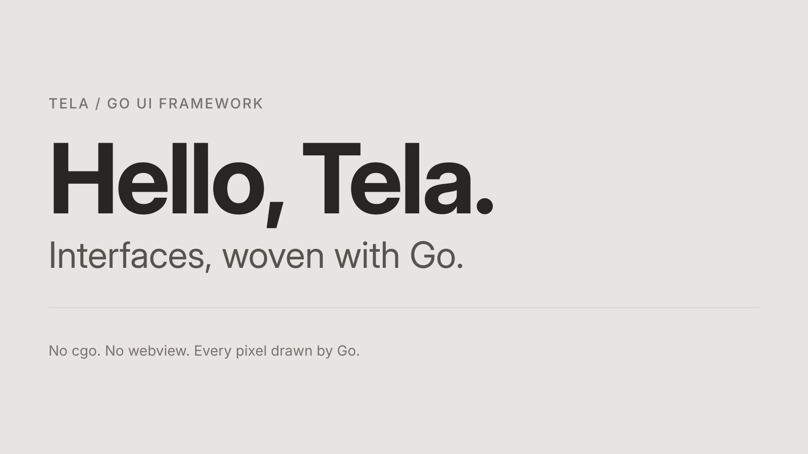

# Tela

Tela is a desktop UI framework written in **pure Go**: no cgo, no webview, no
native toolkits. You write components (structs with a `Build` method, or
functions) with React-style hooks and style them with Tailwind v4 classes; Tela draws every pixel itself, on Linux
(Wayland and X11) and Windows. The same tree also renders without a window, to
a PNG and to a text tree, so both people and LLM agents can build and check
interfaces without trial and error.



```go
func Counter() tela.Node {
	count, setCount := tela.UseState(0)

	return Div(Class("flex items-center justify-center h-full bg-stone-200"),
		Div(Class("flex flex-col items-center gap-6 w-80 p-10 rounded-2xl",
			"bg-stone-50 border border-stone-300 shadow-xl text-stone-800"),
			Span(Class("text-sm font-medium tracking-widest text-stone-500"), Text("COUNT")),
			H1(Class("text-8xl font-bold tracking-tight tabular-nums"), Textf("%d", count)),
			Button(Class("w-full py-3 rounded-xl bg-stone-800 text-stone-100 font-medium",
				"hover:bg-stone-700 active:scale-95 transition"),
				OnClick(func() { setCount.Update(func(n int) int { return n + 1 }) }),
				Text("Increment"),
			),
		),
	)
}
```

> **Status: pre-1.0.** The public API (`tela`, `h`, `telatest`) may still
> break between minor versions. macOS (13 or later) has a native backend,
> verified on CI but not yet on a real Mac. See the [project status](https://github.com/kuronosu/tela#project-status).

## Guides

| Page | What you learn |
|---|---|
| [Getting Started](Getting-Started) | Install, write a counter, run it, render it without a window |
| [Styling](Styling) | Tailwind classes, typed style props, variants, dark mode |
| [Theming](Theming) | Semantic colors (shadcn/ui names) that follow the color scheme, radius and fonts, `Scheme` for part of the window, `UseTheme`, class aliases |
| [Hooks](Hooks) | State, effects, intervals and goroutines, memoization, context, refs, observable values |
| [Events](Events) | Pointer, keyboard, focus, drag, long press, wheel |
| [Elements and Props](Elements-and-Props) | Everything package `h` exports and how elements compose |
| [Forms and Text Input](Forms-and-Text-Input) | `Input`, `Textarea`, `Form`, `Label`, IME |
| [Scrolling and VirtualList](Scrolling-and-VirtualList) | Scroll containers, scroll APIs, 100,000-row lists |
| [Animation](Animation) | Transitions, `starting:`, springs and tweens, enter and exit with `Presence`, layout animations |
| [Internationalization](Internationalization) | Message catalogs (ICU), plurals, locale-aware numbers, dates and lists, switching the language at run time |
| [Icons](Icons) | `h.Icon`, the Lucide set, generating an icon set from SVG files with `tela icons gen`, what icons cost in a binary |
| [Kit](Kit) | Ready-made components in the look of shadcn/ui: the shape of a component, controlled and uncontrolled values, trigger slots, customizing with theme tokens, recipes and classes, and every component with an example |
| [Aria](Aria) | Behavior hooks: press, hover, focus, buttons, checkboxes and switches, and `UseFloating` for popovers, tooltips and menus |
| [Windows and Desktop](Windows-and-Desktop) | Several windows with `tela.Window`, `UseWindow`, custom title bars, file dialogs, message boxes, notifications, the tray, settings, remembered window placement, app folders, what each platform lacks |
| [Desktop Integration](Desktop-Integration) | Drag and drop with files and other applications, the clipboard, global shortcuts, one running instance and launches, registering `notes:` links and file types, secrets in the OS's keyring, native menus, high contrast and the text scale, and how `tela dev` and each platform differ |
| [Accessibility](Accessibility) | Roles, ARIA props, aria snapshots |
| [Testing](Testing) | `telatest`: mount, click, expect, goldens, without a window |
| [CLI](CLI) | `tela snapshot`, `tela inspect`, `tela icons gen`, debug overlays, environment variables |

## API reference

Every symbol is documented on pkg.go.dev. The wiki also carries the same doc
comments as generated pages, which in addition list the fields and
methods of the event, state and element-handle types (pkg.go.dev shows only
the aliases for those).

| Package | Import path | pkg.go.dev | Wiki |
|---|---|---|---|
| `tela` | `github.com/kuronosu/tela` | [docs](https://pkg.go.dev/github.com/kuronosu/tela) | [API-Reference-tela](API-Reference-tela) |
| `h` | `github.com/kuronosu/tela/h` | [docs](https://pkg.go.dev/github.com/kuronosu/tela/h) | [API-Reference-h](API-Reference-h) |
| `aria` | `github.com/kuronosu/tela/aria` | [docs](https://pkg.go.dev/github.com/kuronosu/tela/aria) | [API-Reference-aria](API-Reference-aria) |
| `desktop` | `github.com/kuronosu/tela/desktop` | [docs](https://pkg.go.dev/github.com/kuronosu/tela/desktop) | [API-Reference-desktop](API-Reference-desktop) |
| `telatest` | `github.com/kuronosu/tela/telatest` | [docs](https://pkg.go.dev/github.com/kuronosu/tela/telatest) | [API-Reference-telatest](API-Reference-telatest) |
| `kit` | `github.com/kuronosu/tela/kit` | [docs](https://pkg.go.dev/github.com/kuronosu/tela/kit) | [API-Reference-kit](API-Reference-kit) |

For LLM agents, [`docs/llms.txt`](https://github.com/kuronosu/tela/blob/main/docs/llms.txt)
is the whole guide in one file (the API, the kit, the `tela mcp` loop and a
complete settings screen), with every code block checked against the API.

The design is in
[`docs/ARCHITECTURE.md`](https://github.com/kuronosu/tela/blob/main/docs/ARCHITECTURE.md);
full screens to imitate are in
[`examples/`](https://github.com/kuronosu/tela/tree/main/examples).
