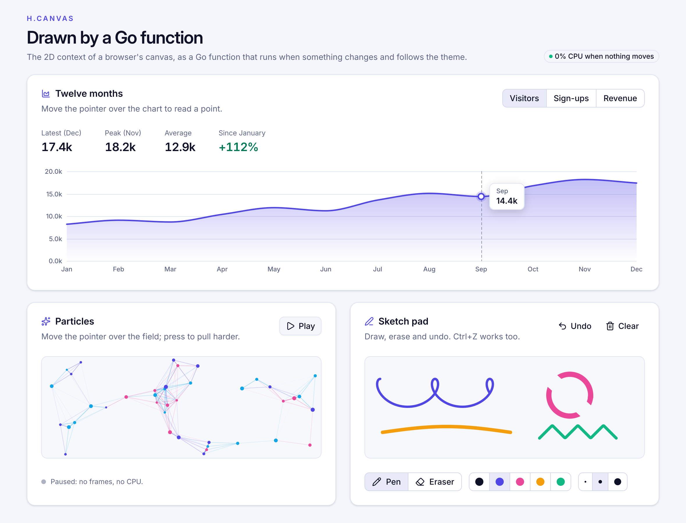

# canvas

Three things drawn by Go functions with `h.Canvas`, the 2D drawing context of a browser's canvas (ADR-319), in one page of `kit` cards that follows the light and the dark scheme:

- **An area chart** (`chart.go`): a smooth line (a monotone cubic, so it never goes above or below its points) over a gradient fill, a value axis whose labels are measured (`MeasureText`: the plot starts after the widest one), a month axis that skips every other label when they do not fit, and a cursor that follows the pointer, snaps to the nearest point and draws its value in a tooltip, inside the canvas. The cursor is a `tela.Value` set in `OnPointerMove` from `e.LocalX` and read with `Get` inside the draw: moving the pointer paints the canvas and builds no component (`TestChartCursorBuildsNothing`). The three series (the buttons above it) change with a spring: a `Value` that `tela.Animate` moves from 0 to 1, and the draw interpolates the old values and the new ones (and the top of the axis) by it; under reduced motion it jumps. The values are text too: the stats above the chart, and a paragraph for assistive technologies (`sr-only`) that says every month.
- **A particle field** (`particles.go`): the simulation is a `UseRef`, moved in the draw by `c.Delta` and kept going with `c.RequestFrame()`. The dots are pulled to the pointer (harder while it is pressed, with a ring round it so they do not clump) and drawn with lines between the ones that are near. Pause stops it: no more `RequestFrame`, so the window asks for no frames and the CPU goes to 0 (`TestParticlesRunAndRest`: `ExpectIdle`, and no frame in ten seconds). Under reduced motion (`tela.UseReducedMotion`) it starts paused, as a still. The dots come from a fixed seed, so a snapshot is always the same picture.
- **A sketch pad** (`sketch.go`): freehand strokes kept in a `tela.Value` that the draw reads, so a stroke grows without a build of the page (`TestSketch` measures it). Five inks that are theme tokens (a stroke follows the color scheme), three brushes, an eraser that draws with `CompositeDestinationOut` (it takes away what the strokes drew and shows the pad's own background, which is not part of the canvas), undo, clear and Ctrl+Z. The controls are `kit.ToggleGroup`s and buttons, reached with Tab and the arrow keys. The pad itself is drawn with a pointer; a click is a dot.

Every canvas has an accessible name (`role img` and `AriaLabel`); `tela check` and `tela verify` find nothing.

## Run it

- In a window: `CGO_ENABLED=0 go run ./examples/canvas` (1180x900; the color scheme is the system's).
- Without a window: `CGO_ENABLED=0 go run ./cmd/tela snapshot --size 1180x900 --scale 2 [--dark] -o canvas.png ./examples/canvas` (the preview `Overview` has the chart read at September, the particles at rest and a drawing on the pad).
- Tests: `CGO_ENABLED=0 go test ./examples/canvas`. They check the cursor (and that it builds nothing), the series and their spring, the particles (running, paused, reduced motion, the pull of the pointer, no layout per frame), the pad (draw, erase, undo, Ctrl+Z, clear, a dot, colors and brushes, the keyboard), that the screen goes idle, `ExpectAccessible`, the aria snapshot (`testdata/canvas.aria.yml`) and the goldens (`testdata/*.png`: light and dark at scale 1 and 2, a narrow window, a hovered chart and a pulled field; regenerate with `TELA_UPDATE=1 CGO_ENABLED=0 go test ./examples/canvas`).
- The icons are Lucide's (`icons/`, generated by `tela icons gen`).
