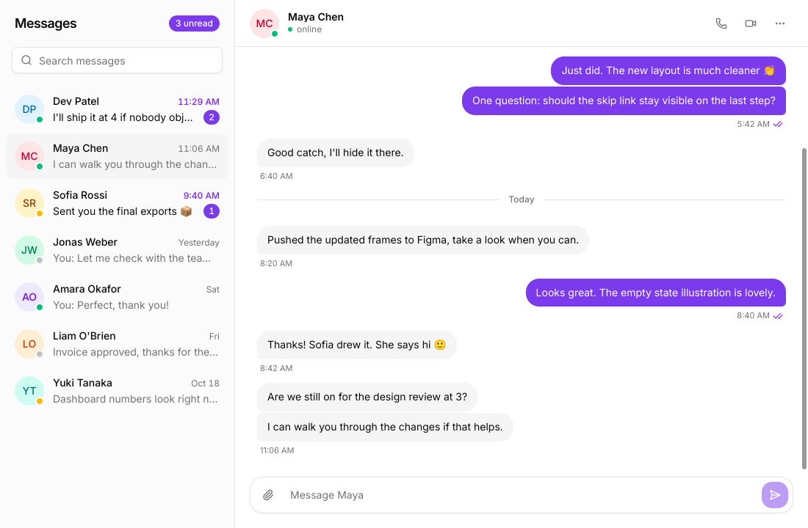

# chat

A messaging app screen built only on package `kit` in its default style, with a violet primary color: a sidebar with a search box and the conversations, and the open conversation next to it with its header, its messages and a composer. Sending a message shows a typing indicator for a moment, then the other side answers.

What it shows:

- **One reducer for the whole state.** `Store` (`model.go`) is the conversations, the open one and the day, in `tela.UseReducer`; a selection, a draft, a sent message and a reply are `Action`s on a pure `reduce`, so the model has no UI in it. The root stamps the clock on the actions that make a message, so the tests choose the time (`Chat{Clock: ...}`).
- **Comparable pieces as props.** `Conv`, `Person` and an immutable `*Thread` are comparable, and the rows, header, list and composer are struct components that receive only their piece plus a `tela.Callback[func(Action)]`. Typing in the composer changes the store on every key and builds the root, the sidebar, the row of the draft and the composer; the header and the message list skip (`TestRebuildsAreNarrow`).
- **The reply is `tela.UseTimeout`.** While someone is typing, the root waits `replyDelay` on the frame clock; its dependency is the pending reply, so a new message restarts the wait, and `0` cancels it. There is no goroutine: the tests move it with `App.Advance`. The reply lands in a conversation that is not open too, as an unread count.
- **A virtualized message list that scrolls to its end.** `h.VirtualList` builds only the rows in view; a `UseLayoutEffect` calls `ScrollToIndex(last, tela.AlignEnd)` on the list's `ElementRef` after layout and before paint, so a conversation opens and a message arrives with no flash at the top. Its dependencies are the number of rows and whether the indicator is shown. The rows are day separators and bubbles (`Item`), grouped by sender and time, with squared corners where bubbles touch, and the time and read ticks (`Check`, `CheckCheck`) under the last of a group.
- **`h.AriaCurrent("page")`.** The row of the open conversation is marked, reported to assistive technologies and styled with the `aria-[current=page]:` variant (`telatest.Current("page")` in the tests). The rows are buttons, so Tab reaches them and Enter opens one.
- **The typing dots** are three spans with `animate-[bounce_1s_150ms_infinite]`: the keyframes of `animate-bounce` with a delay each, in the arbitrary animation shorthand.
- **A growing composer.** A `kit.Textarea` that grows to ten lines (`field-sizing-content` and `max-h-40`) inside a box that takes the focus ring; Enter sends and Shift+Enter writes a new line (an `OnKeyDown` that prevents Enter's default), the send `kit.Button` is disabled while the draft is blank, and the focus goes back to the field after sending. The draft is part of the store, so it is kept per conversation, and the sidebar shows it as `Draft: ...`.
- **kit parts.** `kit.Input` (search, with its icon placed over it), `kit.Avatar` (initials with a tint per person and a presence dot), `kit.Badge` (unread counts), `kit.Tooltip` on the icon buttons, `kit.DropdownMenu` (mute and clear, with a destructive item), `kit.Separator` (day lines), `kit.Button`. Everything else is theme tokens (`bg-muted`, `text-muted-foreground`, `border-border`), so the screen follows the color scheme; only the avatar tints and the accent text have `dark:` classes. Icons are a Lucide subset in `icons/` made with `tela icons gen`.
- **Accessible names.** A row is named `Dev Patel, 2 unread`, a message `You, 2:33 PM` (an `article`), the list is a `log`, the typing dots a `status`; `testdata/chat.aria.yml` pins it.

## Run it

- In a window: `CGO_ENABLED=0 go run ./examples/chat` (1100x720).
- Without a window: `CGO_ENABLED=0 go run ./cmd/tela snapshot --scale 2 [--dark] -o chat.png ./examples/chat`.
- Driven by an agent: `tela mcp ./examples/chat`, then `fill` the textbox "Message", `press` Enter, `wait` 2000 ms and look at the `screenshot`.
- Its aria snapshot: `CGO_ENABLED=0 go run ./cmd/tela inspect --size 1100x720 ./examples/chat`. The times in it depend on the clock; the golden uses the tests' (2:32 PM).
- Tests: `CGO_ENABLED=0 go test ./examples/chat`. They drive the screen through a headless window with a fixed clock: the open conversation and its mark, the search, sending with Enter and with the button, Shift+Enter, the disabled send button, the typing indicator and the reply after `Advance`, the list at its end, drafts and messages kept across conversations, a reply in a conversation that is not open, the menu, the narrow rebuilds, a damage check, and the goldens (`testdata/chat_x*.png`, `chat_dark_x*.png`, `chat_typing_x*.png`, `chat_switched_x*.png`, `chat_switched_dark_x*.png`; regenerate with `TELA_UPDATE=1 CGO_ENABLED=0 go test ./examples/chat`).

The people and the messages are made up (`data.go`); each person answers with the lines of their script, in order.
