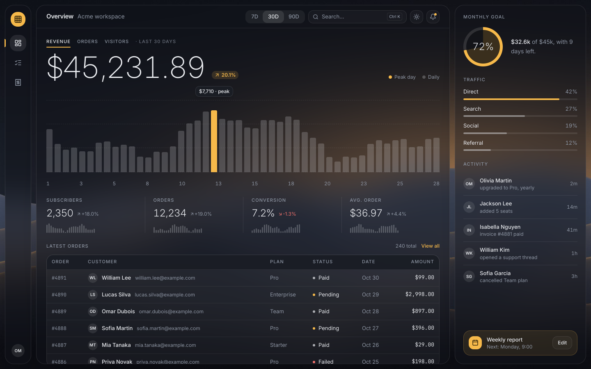
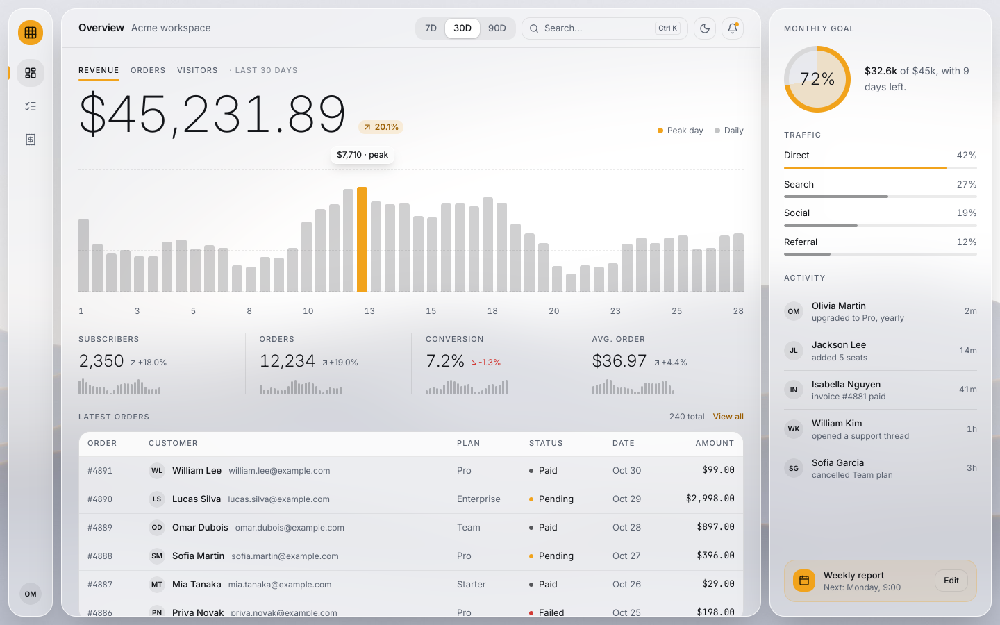
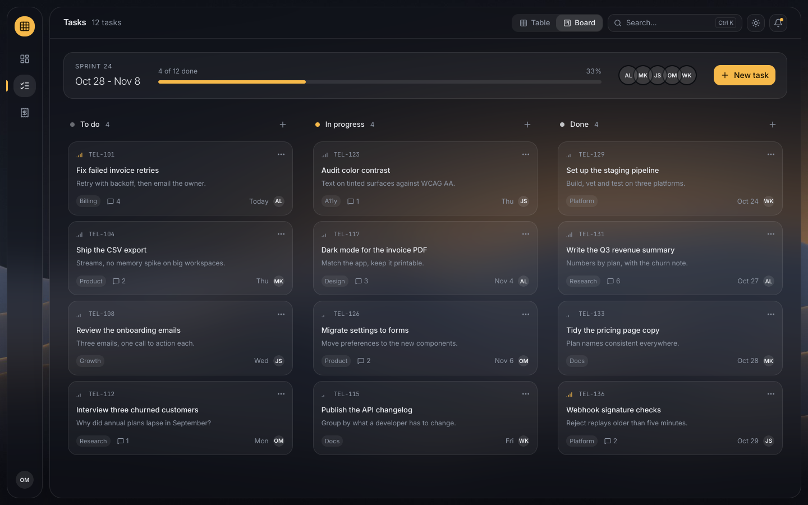
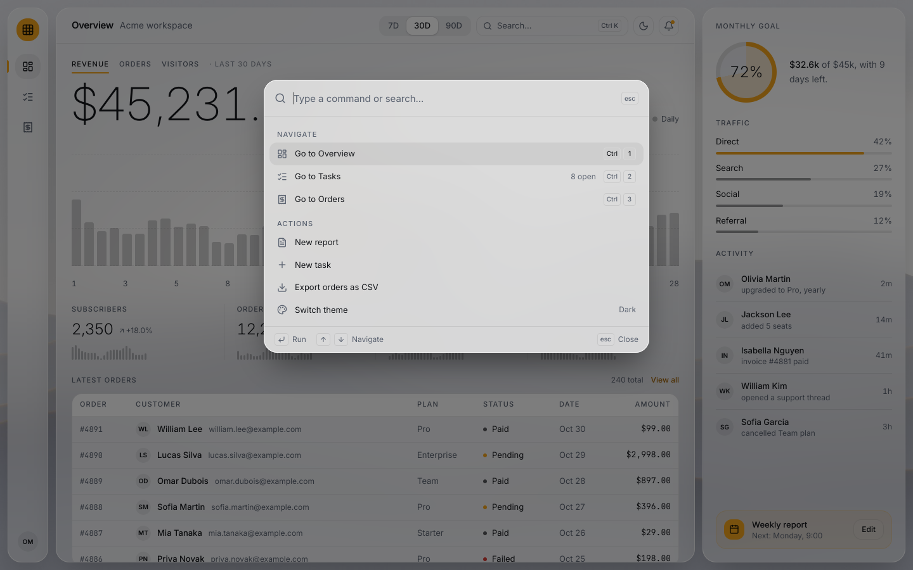

# dashboard

"Frosted graphite": an analytics dashboard, dark first, in the manner of Apple's materials and Raycast. A calm dune wallpaper, three fixed panes of real glass over it (the rail, the main pane and the Pulse pane) and one amber accent. Only the content inside a pane scrolls, so what each blur samples never moves. It is the screen of the phase-16 criterion: the GPU backend draws it at 60 fps at scale 2, and the CPU rasterizer does not (see [Performance](#performance)).

| Dark | Light |
|---|---|
|  |  |
|  |  |

## What it has

- **Overview** (`overview.go`). A headline with metric tabs (a `kit.Tabs` whose amber line slides between the tabs, a `LayoutID`), the number and a spectrum of 48 bars, each with its value in a tooltip; four figures with sparklines; the 30 latest orders in a `kit.Table` that scrolls in place, with a link to the orders view; and the Pulse pane: the monthly goal as a ring, the traffic, the activity feed and the weekly report, whose Edit button opens the report dialog. The period switch (7D, 30D, 90D) moves every number.
- **Tasks** (`tasks.go`, `board.go`, `actions.go`, `model.go`). One model, the board (three columns of task IDs, a comparable array), shown two ways. The table has a checkbox that finishes a task (its card moves to Done, and back) and columns that sort; finished tasks stay last, and every cell slides to its new place (`AnimateLayout`). The board's cards are dragged between columns, dropped between two cards or reordered in their column; a card's ellipsis (`kit.DropdownMenu`) and the card itself (`kit.ContextMenu`, Shift+F10 from the keyboard) have Move to (a full column is disabled), Edit and Delete; Edit, New task (the sprint strip and every column's +) and Delete open a `kit.Dialog` or a `kit.AlertDialog`, and answer with a toast. The sprint strip counts what is done with a bar that follows a spring.
- **Orders** (`overview.go`). 240 orders in a table that fills the pane, filtered by status.
- **The shell** (`shell.go`, `main.go`). The rail (a button per view, each with a tooltip and an amber bar that slides to the active one), the top bar (the view's own segmented control, the search button that opens the palette, the theme button, the notifications in a `kit.Popover`), the toasts (`kit.Toaster`), and Ctrl+K (the palette) and Ctrl+1, 2, 3 (the views).
- **The command palette and the tooltips** (`palette.go`) are built directly on `aria` hooks, with no kit component: the palette is an overlay (`UseOverlay`, modal) holding a dialog (`UseDialog`) around a combobox (`UseCombobox`) whose list is always open and filters the commands while the input keeps the focus (the arrows move a virtual focus, `aria-activedescendant`); a tooltip is `UseTooltipTrigger` placed by `UseFloating`. The commands navigate, open the report and new-task dialogs, export the orders (a toast) and switch the theme.

Everything else is package `kit` in a recipe of its own (`style.go`): the kit's theme with the graphite tokens, dark first (`pane`, `pane-border`, `menu` and `accent-text` besides shadcn/ui's names), and `kit.DefaultStyle()` edited (hairline cards, an amber primary button, the segmented control with a pill that slides, small uppercase tabs, the glass dialogs, nearly opaque menus) and applied with `kit.StyleProvider`. The numbers, the 48 bars, the 96 sparkline bars and the sprint bar follow springs read by deferred props (`tela.UseSpring` with `h.TextFn`, `tela.HeightFn`, `tela.WidthFn`), so they move without building anything per frame.

The previews: `1 Overview` (the peak's tooltip open, as in the goldens), `2 Board`, `3 Tasks`, `4 Command palette`, `5 Report dialog`, `6 Toast` (a toast is state set by an effect, which `tela snapshot` does not draw: `TestGoldenStates` shows it) and `7 Orders`. `img/gen.go` draws the two wallpapers from arithmetic alone.

## The glass budget

A `backdrop-blur` is computed again for every pixel that is painted again under it, and on the CPU that is the largest cost of the page (about 25 ns per blurred pixel on one core; the CPU rasterizer keeps no blurred backdrop between frames). The design is heavy on purpose, as the GPU backend's target, but scrolling and resting must stay cheap, so:

1. **Blur only where the backdrop is fixed.** The three panes blur the wallpaper, which never moves, and only their content scrolls. The damage of a frame stays what changed (a scrolled table, a bar that grows), and a pane at rest costs nothing.
2. **No `backdrop-blur` inside an element that is a layer** (opacity under 1, a blend mode, a filter, an animated transform): it turns off the parallel rasterization of the whole frame while it is on screen. The menus, the select's list, the notifications, the tooltips and the toasts animate in and out, so they use the nearly opaque `menu` fill and no blur; the dialogs and the palette blur and animate only their panel's entrance, a few frames.
3. **No fade over the whole window.** A scrim that fades repaints the whole window on every frame of it: the dialogs' scrim and the palette's appear at once. The palette's veil is a plain translucent scrim, not the blurred veil of the proposal: with `backdrop-blur-[3px]` under it, moving the highlight between two commands cost 31 ms at 1080p (81 ms at scale 2) instead of 24 (54).
4. **No transition on what a drag crosses.** A transition restyles the page on each of its frames, and a frame that restyles records every layer again; the cards and the columns change at once when the pointer crosses them, so a drag moves one layer and records nothing (`TestDragMoveRecordsNothing`).
5. **Tables build every row.** A `kit.Table` is not virtualized, and the overview lays out again on every frame of its springs: the overview shows the 30 latest orders, the orders view all 240 (240 rows on the overview made its pipeline five times slower).

The damage of a change under a pane also grows by the blur's reach (about 120 px on each side at `backdrop-blur-2xl`), even for content painted above the blur: dragging a card repaints a region about twice its size.

## Performance

`bench_test.go` drives the page without a window through a scripted session of 1,095 ticks of a 60 Hz clock: hover sweeps over the rail, the spectrum and the rows, a period change, a metric tab, scrolling and a fling in the latest orders, the report dialog and its toast, the palette, finishing and sorting a task, dragging a card across the board, and two theme switches. A frame is timed like `core.Host` runs it (input, animate, build/style/layout/paint, rasterization of the damage, the copy to a presentable buffer, effects) and runs only when the tree asked for one. After the session the page must ask for no frames at all.

```sh
TELA_PERF=1 CGO_ENABLED=0 go test -run TestSession -v ./examples/dashboard   # the full tables, one session per configuration (without TELA_PERF, 1080p at scale 1 only)
CGO_ENABLED=0 go test -run xxx -bench Session -benchtime 1x -count 3 ./examples/dashboard
CGO_ENABLED=0 go test -run xxx -bench 'FullFrame|ScrollFrame|DragMove' ./examples/dashboard
```

Medians of three runs on an i5-10400 (12 threads, so 12 raster workers), frame time in ms, against the glass page this one replaced (the kit page of ADR-144: a sticky header, cards without blur over an aurora, a page that scrolls under the header), run interleaved on the same machine:

| Configuration | Page | frames | p50 | p95 | p99 | max |
|---|---|---|---|---|---|---|
| 1920x1080, scale 1 | before | 527 | 2.9 | 20.7 | 22.5 | 32.4 |
| | Frosted graphite | 676 | 15.2 | 34.4 | 41.4 | 60.7 |
| 1920x1080, scale 2 (3840x2160 px) | before | 528 | 6.1 | 65.6 | 70.8 | 74.6 |
| | Frosted graphite | 676 | 48.4 | 113.1 | 128.5 | 147.3 |
| 1440x900, scale 2 (2880x1800 px) | before | 486 | 6.3 | 46.9 | 50.2 | 52.4 |
| | Frosted graphite | 655 | 30.4 | 82.5 | 97.0 | 110.8 |

| Benchmark (ms per frame) | Page | 1080p x1 | 1080p x2 | 1440x900 x2 |
|---|---|---|---|---|
| `BenchmarkFullFrame` (the whole window) | before | 16.6 | 51.7 | 32.6 |
| | Frosted graphite | 25.8 | 85.0 | 56.5 |
| `BenchmarkScrollFrame` | before (the page under the header) | 20.9 | 67.3 | 44.6 |
| | Frosted graphite (the orders view: a table that fills the main pane) | 36.7 | 108.8 | 72.9 |

The sessions differ (this one has the palette, the tasks and the board), so the percentiles compare the two pages' typical frames, not the same actions. What costs is the glass: with the panes' `backdrop-blur-2xl` taken out, a full frame at 1080p takes 10.5 ms instead of 25.8 and a scroll frame 17.7 instead of 36.7. A frame whose damage is under a pane (a spring of the spectrum, a row that slides, a scrolled table) rasterizes the blur of the wallpaper again for every pixel of it and of the blur's reach around it: the period change runs at 18 ms per frame at 1080p for 0.8 Mpx of damage, a scroll of the latest orders at 16 ms. Frames that change little stay cheap (a hover over the rail or the spectrum: 6 ms, with a tooltip; the settle: 4 ms), and the page at rest asks for no frames (`TestIdle`, `TestGoesIdle`, and the end of every session). Per scene at 1080p, scale 1 (p50, p95 in ms): hover sweep 6.3, 7.6; period 18.0, 20.3; metric tab 14.9, 16.8; scroll and fling 15.6, 32.4; dialog and toast 12.9, 37.1; palette 2.9, 26.0; finish and sort 27.1, 35.1; board drag 14.1, 38.0; theme switch 26.5, 28.8.

So the CPU path does not reach 60 fps on this page even at scale 1 (253 of 676 frames over 16.7 ms), and at scale 2 its median frame is 48 ms: the gap that phase 16's GPU backend has to close. The worst phase is always the rasterizer; the pipeline (build, style, layout, paint) has a p50 of 1.5 ms.

## Run it

- In a window: `CGO_ENABLED=0 go run ./examples/dashboard` (1440x900). `TELA_DEBUG=fps` shows the frame times.
- Without a window: `CGO_ENABLED=0 go run ./cmd/tela snapshot --size 1440x900 --scale 2 [--dark] [--preview "4 Command palette"] -o dashboard.png ./examples/dashboard`.
- Tests: `CGO_ENABLED=0 go test ./examples/dashboard`. `board_test.go` has the board's (from the old `examples/board`), `palette_test.go` the palette's and the tooltips', `drag_bench_test.go` the drag's damage and bench, `damage_test.go` and `idle_test.go` check every frame against a full rendering and that the page goes idle. The goldens (`testdata/`) are regenerated with `TELA_UPDATE=1 CGO_ENABLED=0 go test -run 'Golden|Aria' ./examples/dashboard`.
