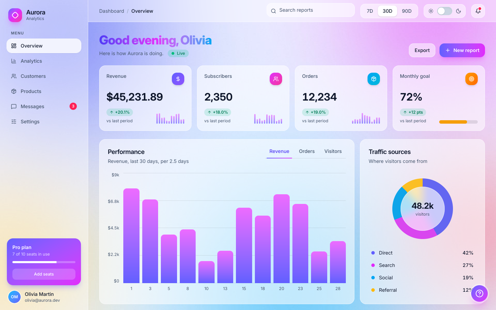

# dashboard

An analytics dashboard in the glassmorphism style, light and dark: a sticky glass header and sidebar, four stat cards, a bar chart, a donut, a sortable task table, an expanding card and a table of sales, over a colorful backdrop. It is the showcase of Tela's phase-6 vocabulary on one screen, and the "60 fps at 1080p on CPU rendering" target of that phase (see [Performance](#performance)).

| Light | Dark |
|---|---|
|  |  |

It is built only on package `kit`: every control is a kit component (the segmented controls are `kit.ToggleGroup`, the switches `kit.Switch`, the dialog `kit.Dialog`, the toasts `kit.Toaster`, the lists `kit.Table`, the cards `kit.Card`...) and the glass look is a kit recipe, so the page doubles as the test that [customization](../../kit/doc.go) is enough. The charts (bars, sparklines, donut, goal meter) are the example's own drawing: they are content, not controls.

## The glass recipe

`glass.go` is the three levels of kit customization (ADR-129, K17):

1. **Tokens.** `theme` is `kit.Theme()` with the colors of the page, and the glass lives in them: `border` is a hairline of `white/60` (`white/10` in dark), `card` a translucent fill, `popover` the fill of the dialog and the toasts, `accent` the lighter pill of a hover or a selection, `secondary` a pane. A kit class such as `border-border` or `bg-card` is then already glass, one class serves both schemes, and the page's own markup uses `text-foreground` and `text-muted-foreground` instead of `dark:` pairs. `App.Theme` and the bench's `core.Config` take it.
2. **Recipes.** `glassStyle()` edits `kit.DefaultStyle()` and `kit.StyleProvider` applies it to the whole page. What a token cannot say is a class in a recipe or a new variant: `s.Card.Root` (rounded-2xl, no shadow, no blur), the default `Button` is the indigo-to-fuchsia gradient and `s.Button.Variants` adds `"glass"`, `"tint"`, `"nav"` and `"fab"` (and a `"nav"` and `"fab"` size); `s.Badge.Variants` adds `"live"`, `"syncing"`, `"up"`, `"down"`, `"soft"` and `"tint"`; the switch, the checkbox and the segmented control (`ToggleGroup` and `Toggle`) have gradient and pill classes; `s.Dialog` and `s.Toast` are the frosted panels with `backdrop-blur-xl` (the scrim has no fade: see the budget below); `s.Table` makes a list in a card.
3. **Per instance.** `Class` and the slot classes change one component: the stat cards lift when hovered (`Class: lift`), the sort chips are a small `ToggleGroup` (`Size: kit.Sm`), the insight card is a `kit.Card` whose `Class` is its gradient.

What the page keeps its own: the gradient headline (`bg-clip-text`), the backdrop image, the donut (`bg-[conic-gradient(...)]`), the `mix-blend-overlay` highlight, and the springs.

What it shows, by file:

- **Grid, sticky and fixed** (`main.go`, `chrome.go`). The page is `grid lg:grid-cols-[16rem_1fr]`; the card rows are `grid grid-cols-2 xl:grid-cols-4` and `xl:grid-cols-3` with `col-span-2`. The sidebar is `sticky top-0 h-screen`, the header `sticky top-0` over the scrolling content, the help button (a `kit.Button` variant) `fixed right-6 bottom-6`.
- **Glass** (`glass.go`, `backdrop.go`). Translucent panels with a hairline over an image registered with `tela.Assets` (`bg-[url(img/aurora-light.jpg)]`, chosen per scheme with `tela.UseColorScheme`; `img/gen.go` draws both), `backdrop-blur-xl` where there is detail behind it, a `bg-clip-text` gradient headline, a conic-gradient donut with a blurred disc over its middle, and a `mix-blend-overlay` highlight on the gradient card.
- **Transitions** (everywhere). `transition duration-200 hover:` on buttons and rows (the button recipe), the lift on the cards, `active:scale-95`, `group-hover:` bar tooltips, and `animate-spin` for the "Syncing" badge after a period change (`LiveBadge`).
- **Springs and deferred props** (`cards.go`). The numbers, the 12 chart bars and the 48 sparkline bars follow their targets with `tela.UseSpring`; the number is an `h.TextFn`, the heights are `tela.HeightFn`, the goal meter is `tela.WidthFn` and `tela.BgFn` (rose, amber, emerald as it fills). Switching the period or the tab moves all of them without building anything per frame. The goal meter is not a `kit.Progress` because a `Progress` is built from a value, and this one changes every frame without building.
- **Layout animations** (`lists.go`, `chrome.go`, `overlays.go`). The cells of the task table have `AnimateLayout` (`Column.CellProps`): sort it, or check a task off and it sinks, and every cell slides to its new place. The nav pill, the period pill, the chart's tab underline (`Tabs.Indicator`) and the dialog's format pill are `LayoutID`s that slide from the item that loses them; a segmented control's pill is a child of its `ToggleGroupItem`. The insight card expands with `AnimateLayout` on itself, its header and its details.
- **Overlays** (`overlays.go`, `glass.go`). `kit.Dialog` (opened by the New report button, which is its `Trigger`) and `kit.Toaster` with `kit.UseToast`: the dialog enters with `starting:` and leaves with `Exit` inside a `Presence`, and a toast is shown by any component with `kit.UseToast().Success(...)`.
- **Environment** (`chrome.go`, `glass.go`). Tokens for both schemes plus `dark:` where a palette color is used; the Day/Night `kit.Switch` calls `tela.SetColorScheme`.
- **Previews.** `tela snapshot --preview "2 Dialog"` renders the dialog; `"3 Toast"` starts the page with a toast, which `tela snapshot` does not draw (a toast is state in the Toaster, set by an effect, and a one-shot render does not deliver it: `TestGoldenToast` shows it with `telatest`).

## The glass budget

A `backdrop-blur` recomputes its pixels whenever what is behind it changes, and a card that scrolls over a fixed backdrop has a different backdrop on every scroll frame. So the page spends blur where there is detail to frost (the header, the dialog, the toast, the donut's disc) and gives the cards, which sit over a smooth image, a translucent fill and an edge. Four things made the difference between 30 and 14 ms per frame at 1080p, and are worth knowing when writing your own glass:

1. Blur per card is the largest cost (about 25 ns per blurred pixel on one core).
2. A `backdrop-blur` inside an element that is a layer (opacity under 1, a blend mode, a filter, an animated transform) turns off the parallel rasterization of the whole frame while it is on screen. The insight card's chips have no blur for this reason: the `"tint"` button variant has none, and the sidebar's "Add seats" adds `backdrop-blur` with its own `Class`.
3. Soft shadows on many cards are not free; the cards have none, and shadows are on the elevated things.
4. A fade over the whole window (a scrim) repaints the whole page on every frame of it, so the dialog's scrim appears at once and only the panel animates; the page's fills do not transition, so switching the theme repaints once.

## Performance

`bench_test.go` drives the page without a window through a scripted session of 935 ticks of a 60 Hz clock (644 frames drawn at 1080p): hover sweeps, a period change, a tab switch, a reorder, scrolling and a fling under the glass header, the dialog, a toast with its countdown, the expanding card and two theme switches. A frame is timed like `core.Host` runs it (input, animate, build/style/layout/paint, rasterization of the damage, the copy to a presentable buffer, effects) and runs only when the tree asked for one. After the session the page must ask for no frames at all.

```sh
CGO_ENABLED=0 go test -run TestSession -v ./examples/dashboard            # the full tables, one session per configuration
CGO_ENABLED=0 go test -run xxx -bench Session -benchtime 1x -count 3 ./examples/dashboard
```

Medians of three runs on a Core Ultra 5 125H (4 CPUs, so 4 raster workers), frame time in ms:

| Configuration | p50 | p95 | p99 | max |
|---|---|---|---|---|
| 1920x1080, scale 1 | 2.1 | 14.6 | 18.8 | 28.5 |
| 1920x1080, scale 2 (3840x2160 px) | 4.2 | 48.5 | 56.0 | 72.2 |
| 1440x900, scale 2 (2880x1800 px) | 5.1 | 36.4 | 41.1 | 55.5 |

The table above is from before the page was rebuilt on `kit` (ADR-144). The rebuilt page measured against the old one on the same machine (a Core Ultra 5 125H is not at hand: an i5-10400, run with `-cpu 4`, which is also 4 raster workers), interleaved, medians of three runs, 1920x1080 at scale 1, frame time in ms:

| Page | frames | p50 | p95 | p99 | max | scroll frame (`BenchmarkScrollFrame`) |
|---|---|---|---|---|---|---|
| hand-made controls | 644 | 3.0 | 23.1 | 29.0 | 38.8 | 24.7 |
| kit, glass style | 527 | 3.2 | 26.7 | 32.2 | 41.8 | 26.9 |

The kit page draws 117 frames fewer because its toast has no countdown tween (a waiting toast draws none: 130 frames of the old "toast and expand" scene are 91) and the theme switch has no knob transition; those were cheap frames, so the percentiles of the whole session shift up (p95 +15%) while the frames that cost something (a scroll frame, +9%) did not change much: the page paints a few more boxes (table cells, badges, rings). The absolute numbers are this machine's, not the table's.

At 1080p and scale 1, 5 of 644 frames take longer than 16.7 ms. The frames that dominate the upper percentiles are the ones that move every pixel: scrolling (the cards move over a fixed backdrop, so the damage is nearly the whole window, 14 ms at 1080p), the first frame of the dialog and the theme switch. Everything else (hovers, springs, layout animations, transitions, the toast) is under 7 ms at p95. The worst phase is the rasterizer (11.9 ms at p95); the pipeline (build, style, layout, paint) is under 2 ms at p95.

## Run it

- In a window: `CGO_ENABLED=0 go run ./examples/dashboard` (1440x900). `TELA_DEBUG=fps` shows the frame times.
- Without a window: `CGO_ENABLED=0 go run ./cmd/tela snapshot --size 1440x900 --scale 2 [--dark] [--preview "2 Dialog"] -o dashboard.png ./examples/dashboard`.
- Tests: `CGO_ENABLED=0 go test ./examples/dashboard`. The goldens (`testdata/`) are regenerated with `TELA_UPDATE=1 CGO_ENABLED=0 go test -run TestGolden ./examples/dashboard`.
