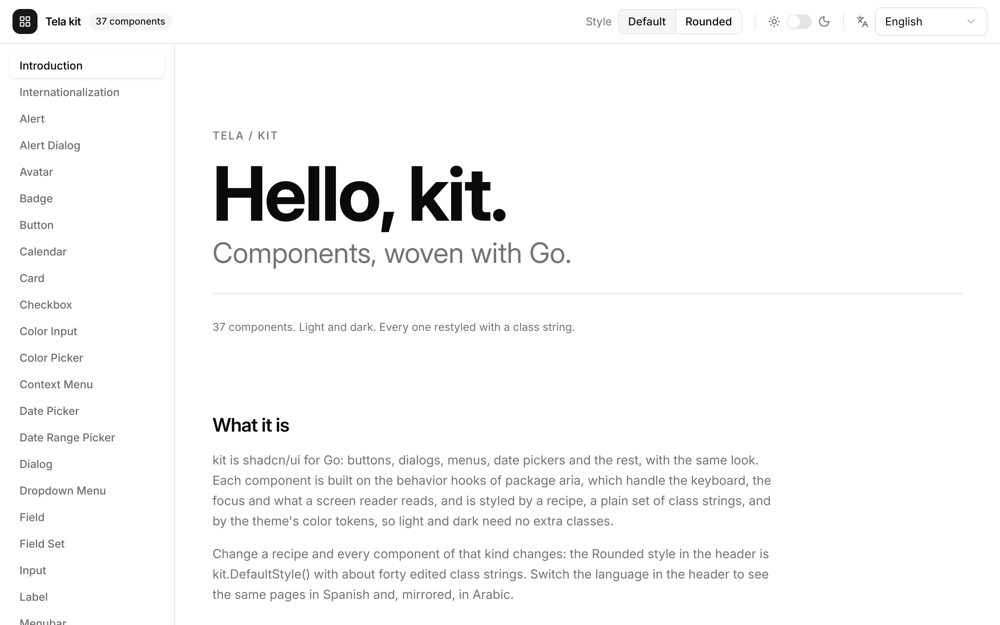
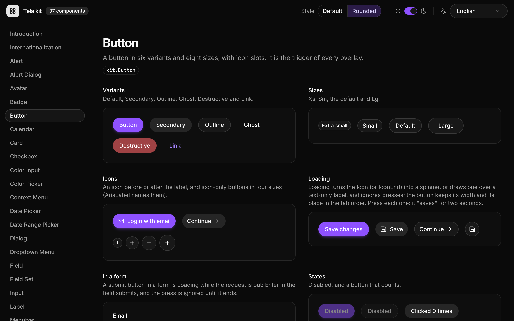

# kit

The gallery of package [`kit`](../../kit): it opens on an Introduction, and has a sidebar with every component and, for each one, a page that shows its variants, sizes and states in a small realistic composition, the way shadcn/ui's documentation does. **Everything on the screen is a kit component**, laid out with `h` elements and theme-token classes; the only hand-made things are the layout boxes of the demos, the page titles and the Introduction's hero.

| Default style, light | "Rounded" style, dark |
|---|---|
|  |  |

## The window

- **Sidebar**: a vertical `kit.Tabs`, one tab per page: the Introduction and the Internationalization page first, then one per component. It is one tab stop; the arrow keys move through the components and select them, Home and End jump, and Tab goes on to the page. Only the selected page is built.
- **Style** (a `kit.ToggleGroup`): "Default" is `kit`'s own recipes; "Rounded" is `kit.DefaultStyle()` plus about forty edits of class strings (`styles.go`): pill buttons and fields, large corners, a violet accent, a gradient progress bar. `kit.StyleProvider` applies it to the whole window, header included, so it is also the demonstration that the recipes are enough to restyle every component without copying source.
- **Dark mode** (a `kit.Switch`): `tela.SetColorScheme`. Every class is a theme token, so no `dark:` class is written in the gallery's own markup.
- **Language** (a `kit.Select`): English, Español and العربية, each named in its own language. It is the gallery's own state, given to `i18n.Provider` (never `i18n.SetLocale`, so a run does not depend on the system's language and tests cannot disturb each other; the one exception is the message box of the Internationalization page, which draws texts outside the tree and so sets the app's locale while it is open and puts the old one back), and the window's root takes its direction from it (`Dir(f.Dir().String())`): in Arabic the whole window mirrors, header, sidebar and page. The catalogs are `locales/{en,es,ar}.json` (ICU MessageFormat, embedded and loaded in `i18n.go`); besides the Internationalization page's messages they hold what kit defaults to English and the pages pass through the fields kit has for it: the date pickers' placeholders, the calendars' previous and next buttons (Arabic also asks for `NarrowWeekdays`, since its short weekday names do not fit a cell), the dialogs' `CloseLabel` and the alert dialog's Cancel and Continue. The gallery's own words (titles, notes, captions, the header's labels) stay English and keep a left-to-right direction in Arabic, so they do not break. What a stage shows (the components' texts) is written with `tr(id, "English")` (`i18n.go`): English in the code, Spanish and Arabic under `gallery.<id>` in the catalogs, on the pages of phase 20's pieces (Alert, Avatar, Badge, Button, Field, Input, Separator, Skeleton, Table, Progress, ToggleGroup, Tooltip, Toast and the three menus); `catalog_test.go` reads the sources and fails for a text without both translations or a message nothing uses. The `tela.*` messages translate what Tela draws itself (the toast viewport and close button, message boxes, title bar, role items of menus). The other pages still have English stages (a known gap: under right to left their sentences end at the wrong side), and the Title Bar and Color Picker pages do not pass the labels their components have fields for (`MinimizeLabel`, `HexLabel`...).
- **A `kit.Toaster`** around the page, for the Toast page's buttons and the toasts of the Dialog page.

## The pages

The **Introduction** (`intro.go`) is the page the gallery opens on, in the spirit of shadcn/ui's docs and of `examples/hello`: an eyebrow in tracked capitals, a very large headline, a tagline, a hairline and a quiet line, then what kit is, a small program that uses it and a button for each component that opens its page (the sidebar follows). It uses theme tokens only. The **Internationalization** page (`intl.go`) shows, for the language of the window, catalog messages with arguments and nested keys, plurals with a counter (the presets walk Arabic's six categories) and an ordinal, the formatter's numbers, percentages, dates, times and lists, and a `DatePicker` that follows the language.

Then one per exported component (the Title Bar page has `TitleBar` and `WindowControls`), 37 in all, alphabetical, in `pieces.go` (Alert, Avatar, Badge, Button, Separator, Skeleton), `basic.go` (Card, Label), `fields.go` and `forms.go` (Input, Field; Textarea, FieldSet), `choice.go` (Checkbox, Switch, RadioGroup, Toggle), `toggles.go` (ToggleGroup), `controls.go` (Select, Slider, Tabs), `progress.go`, `tables.go`, `overlays.go` (Dialog, AlertDialog, Popover), `tooltip.go` (Tooltip, Toast), `menus.go` (DropdownMenu, Menubar, ContextMenu), `dates.go` (Calendar, RangeCalendar, DatePicker, DateRangePicker) and `color.go` (ColorPicker, ColorInput) and `window.go` (TitleBar, WindowControls). `pages.go` lists them; a test reads the sources of package `kit` and fails when a component has no page.

The calendars and date pickers pin "today" to 25 October 2026 (`today` in `dates.go`) so that screenshots are the same every day; an app leaves `Today` unset.

## Previews

`var Previews` has one entry per page, named as the page is (`"Introduction"`, `"Internationalization"`, `"Button"`, `"Calendar"`, `"DatePicker"`...), which shows it over the window's background in the default style and in English, plus `"Gallery"` (the whole window), `"Gallery Rounded"`, `"Gallery Arabic"` (the Date Picker page, right to left) and `"Internationalization es"` and `"Internationalization ar"`. Without `--preview` the CLI renders the first name in byte order, `AlertDialog`.

```bash
CGO_ENABLED=0 go run ./cmd/tela snapshot --preview Button -o button.png ./examples/kit
CGO_ENABLED=0 go run ./cmd/tela snapshot --preview "Gallery Rounded" --dark --scale 2 -o kit.png ./examples/kit
CGO_ENABLED=0 go run ./cmd/tela snapshot --preview "Internationalization ar" --size 1280x1000 -o i18n.png ./examples/kit
CGO_ENABLED=0 go run ./cmd/tela dev --preview Calendar ./examples/kit    # develop a component against its page
CGO_ENABLED=0 go run ./cmd/tela inspect --preview Select ./examples/kit  # the aria snapshot
CGO_ENABLED=0 go run ./examples/kit                                      # the window
```

A preview is as tall as the window; add `--size 1280x1500` to see a long page whole.

## Icons

`icons/` is a Lucide subset (31 icons from lucide-static 1.61.0, with its license) generated by `tela icons gen`, since the root module cannot import `icons/lucide`; see `icons/gen.go`.

## Tests

`CGO_ENABLED=0 go test ./examples/kit`:

| File | Asserts |
|---|---|
| `kit_test.go` | every preview renders in both schemes with dev mode on (no unknown class, hook misuse or undefined variant), every page in both styles and in Spanish and Arabic, `Previews` and the pages agree, and every component of package `kit` has a page |
| `intro_test.go` | the gallery opens on the Introduction, it lists every component and each button opens its page (by pointer and keyboard, in the gallery and in a preview), and it follows Dark and the Rounded style |
| `i18n_test.go` | what `examples/i18n` checked, on the Internationalization page and the Language menu: texts and formats in each language, the plural categories of Arabic and English and the ordinal, kit's defaults from the catalog (date pickers, dialogs, alert dialog), the calendar of each language (month, weekday order and direction, month buttons, unavailable dates), choosing a date, switching the language with the Select by pointer and keyboard (the window mirrors for Arabic and comes back, the state is kept), and the aria snapshots in each language |
| `golden_test.go` | goldens, light and dark at scale 1, bit by bit: the gallery, the Rounded gallery, the Introduction (also whole, and Rounded), the Internationalization page in each language, the gallery in Arabic and Spanish, the Date Picker page in Arabic with its calendar open, the language list, ten pages and the whole Title Bar page, and overlays open (dialog, dropdown menu, date picker, select, toast, the sidebar's focus ring). Regenerate with `TELA_UPDATE=1 CGO_ENABLED=0 go test -run TestGolden ./examples/kit` and look at them |
| `keyboard_test.go` | the sidebar with the keyboard alone (one tab stop, arrows select, Home and End, wrapping, Tab into the page and back), the header's controls, the aria snapshot of the shell (`testdata/kit_gallery.aria.yml`) and of a menu open, focus returning to the trigger |
| `behavior_test.go` | the demos work: a page starts afresh when you come back, the style and dark switches reach every component, select-all, a field's error following the value, toasts, the edit-profile dialog, the alert dialog, choosing a date and a range, sorting a table, sliders with keys, radios, the hex field, tooltips |
| `catalog_test.go` | every `tr` text has a Spanish and an Arabic message with the same placeholders, no catalog message is unused, and every label Tela shows itself (`tela.Labels`) is translated |
| `behavior_new_test.go` | the demos of phase 20: loading buttons (two seconds on the frame clock, the submit in a form), submenus, a context click selecting the option first, the focusable area with Shift+F10, the Edit menu with role items in two languages, tooltips on a toggle, checkbox, switch, slider and menu button (none on a disabled trigger), the download and tween bars, the sliding pill, a table in the Other state, `AlwaysSorted`, the drawn message box in each language, the toaster's names, digits of a locale |
| `golden_pages_test.go` | each new page whole in English, Spanish and Arabic (light) and in dark English where it has colors of its own (`testdata/kit_page_*`) |
| `idle_test.go` | every page, and every overlay open, asks for no frames when nobody touches the window (except the skeleton and the indeterminate bar, which pulse on purpose), and every frame of a tour of the gallery (pages, both switches, a dialog, a menu, a toast) equals a full rendering |

## Gaps the gallery found in `kit`

They are listed in the report of the task that wrote it and in ADR-150; the workarounds in the code are commented where they happen.
