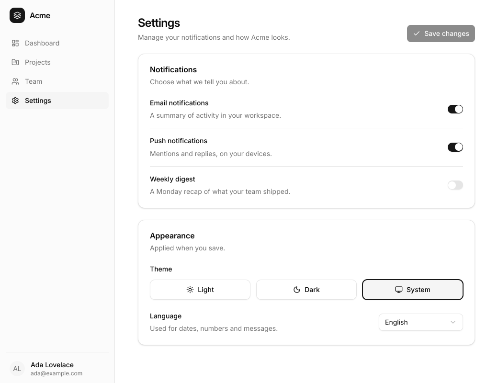

# llms/settings

The worked example of [`docs/llms.txt`](../../../docs/llms.txt), which shows
`main.go` verbatim: an app shell with a sidebar and a settings page, built on
package `kit` in its default (shadcn) style, in one file of about 140 lines.

What it shows, in the order an agent needs it:

- **The contract of the CLI.** `var App` is the window that `main` opens and
  the screen that `tela snapshot`, `tela inspect` and `tela mcp` render, with
  `kit.Theme()` and `RootClass: "bg-background text-foreground"`.
- **Navigation.** The sidebar's buttons carry `h.AriaCurrent("page")` on the
  current item and are styled with the `aria-[current=page]:` variant.
- **Forms on kit.** Switch rows are horizontal `kit.Field`s with
  `ControlAfter`; the theme is a `kit.RadioGroup` inside a `kit.FieldSet`
  (the legend names it) whose options are cards drawn with `Render`; the
  language is a `kit.Select` in a horizontal `Field`.
- **State.** The whole form is one comparable `Prefs` in `UseState`;
  `prefs != saved` disables Save. Save applies the theme with
  `tela.SetColorScheme` and shows a toast (`kit.Toaster` around the app,
  `kit.UseToast`).
- **Tokens only.** No `dark:` class: the page follows the color scheme.

The icons are `lucide/`, a subset of the module
`github.com/kuronosu/tela/icons/lucide` with the same names (the core module
cannot import that module); `docs/llms.txt` shows the import of the real
module, and `internal/gen/llmsdoc` checks that the two files are otherwise
equal.

## Run it

- In a window: `CGO_ENABLED=0 go run ./examples/llms/settings` (1040x800).
- Without a window: `CGO_ENABLED=0 go run ./cmd/tela snapshot --scale 2 [--dark] -o settings.png ./examples/llms/settings`.
- For an agent: `tela mcp ./examples/llms/settings`.
- Tests: `CGO_ENABLED=0 go test ./examples/llms/settings` (goldens light and
  dark at scales 1 and 2, and after Save with the toast; the aria snapshot;
  the switches, the theme, the select and the sidebar). Regenerate the goldens
  with `TELA_UPDATE=1 CGO_ENABLED=0 go test ./examples/llms/settings`.
