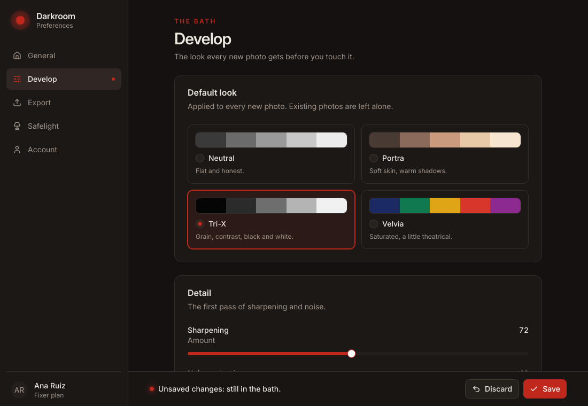

# settings: Darkroom Preferences

The Preferences window of **Darkroom**, a fictional desktop photo editor with the personality of the room where film is developed: a calm, precise voice ("Develop", "Contact sheet", "Safelight", "Fixer") and one accent, the deep red of a safelight. It is built on package `kit` and was written by an LLM from [`docs/llms.txt`](../../docs/llms.txt) and the prompt below, as a test of that guide (see "How it was made").

A sidebar of five sections (General, Develop, Export, Safelight, Account), one shown at a time, and a footer that says whether there is anything to save.

What it shows:

- **The whole form is one comparable value.** `Prefs` (`prefs.go`) holds every setting; `prefs != saved` is the unsaved state. The footer says "Unsaved changes: still in the bath." or "All changes are fixed.", the sidebar puts a dot on each section that changed (`Prefs.changed`), and Discard and Save are disabled until there is something to do. Discard asks first (`kit.AlertDialog`, with `Disabled` on the dialog, not on its trigger).
- **Validation that blocks Save.** The e-mail and the custom export size (a whole number from 256 to 16384) show an error under the field (`kit.Field{Error}`, `Invalid`), and Save is disabled with a footer line that says why.
- **Save applies the theme and the accent at once.** `tela.SetColorScheme` for light, dark or system, and `tela.SetTheme` with a `kit.Theme()` whose `primary` and `ring` tokens are the chosen accent (`makeTheme`), so every `bg-primary` follows. A toast ("Settings fixed.") confirms it. Ctrl+S (Cmd+S on macOS) saves from whichever control has the focus. The saved density sets the space between the cards.
- **Cards for the choices that deserve a picture.** The default look (a swatch strip each), the file format, the theme (a miniature of each) and the accent presets are `kit.RadioGroup` with `Render`: an `h.Button` that takes the group's `RadioState.Props` and `Indicator`, styled with `aria-checked:`. Arrow keys, roles and names come with it.
- **Controls that depend on others.** Quality exists only for JPEG and HEIC; the custom size field only for "Custom"; the watermark text, color and a live preview only when the watermark is on; the thumbnail slider has a live row of thumbnails.
- **Tokens only.** Dark is Darkroom's natural habitat, but there is no `dark:` class: `makeTheme` redefines the warm neutrals as light/dark pairs of tokens and the page follows the scheme. The few fixed colors are content (look swatches, theme miniatures, thumbnail gradients, the watermark preview).
- **Previews as states.** `Previews` are "General", "Develop", "Export", "Safelight", "Account", "Unsaved" and "Invalid"; `Preferences{Start, Scenario}` only chooses the first section and the first value of the form.
- **Library folder** is read-only with a "Change…" button (`desktop.PickFolder`; a platform with no chooser gets a toast).
- **Icons** are a Lucide subset (`lucide/`: also the icons of the code in `docs/llms.txt`), generated by `tela icons gen`.

## Run it

- In a window: `CGO_ENABLED=0 go run ./examples/settings` (1100x760).
- One image per state: `CGO_ENABLED=0 go run ./cmd/tela snapshot --preview Unsaved [--dark] [--scale 2] -o darkroom.png ./examples/settings`; add `--size 1100x1700` to see a whole section.
- Its aria snapshot: `CGO_ENABLED=0 go run ./cmd/tela inspect ./examples/settings` (`testdata/settings.aria.yml`).
- Tests: `CGO_ENABLED=0 go test ./examples/settings`. They drive the window headlessly: the unsaved state and the dots, Discard and its confirmation, the custom size (every bad and good value), the watermark (text and color), quality by format, Save (the toast, the scheme and the accent, checked by pixel), Save disabled while invalid, Ctrl+S and Cmd+S from a focused child, the sign-out confirmation, the sidebar and the controls with the keyboard, the folder chooser, the language, the density; the names of every control (aria), that an idle window asks for no frames, and every frame of a scroll and of a theme switch against a full rendering; and the goldens of the seven previews, light and dark at scale 1 and the Safelight page at scale 2 (`testdata/settings_*.png`; regenerate with `TELA_UPDATE=1 CGO_ENABLED=0 go test ./examples/settings`).

## How it was made

An LLM (Claude Sonnet) was given **only** `docs/llms.txt` and this prompt, and wrote the window (`main.go`, `prefs.go`, `form.go`, 622 lines) in **two render iterations**: it rendered every preview, light and dark, with `tela snapshot`, looked at the PNGs and fixed what it saw; the compiler errors it fixed along the way are not counted. A maintainer then reviewed the code (see below) without changing its structure or its look.

The prompt:

> Build the Preferences window of **Darkroom**, a desktop photo editor, with Tela.
>
> Darkroom has a personality: it is named after the room where film is developed, so its voice borrows from it ("Develop", "Contact sheet", "Safelight", "Fixer"), it is calm and precise, and its one accent is the deep red of a darkroom safelight. Dark mode is its natural habitat, but it must look right in light mode too.
>
> The window is 1100x760 with a sidebar of sections and one section shown at a time. Make it feel like a real, finished product, not a generic settings page.
>
> Sections and what each holds:
>
> - **General**: the library folder (a read-only path with a "Change…" button), what happens on import (copy into the library, or leave files where they are), skip duplicates (switch), and the language (English, Español, Deutsch, 日本語).
> - **Develop**: the default look applied to new photos (choose among four named looks: Neutral, Portra, Tri-X, Velvia, each shown as a small card with a swatch strip), sharpening amount (0–150), noise reduction (0–100), lens corrections (switch), and "auto-straighten horizons" (switch).
> - **Export**: file format as cards (JPEG, PNG, TIFF, HEIC) with a short note each, quality (only for JPEG and HEIC, 1–100), color space (sRGB, Display P3, Adobe RGB), resize long edge (off, 2048, 4096, custom in px with validation 256–16384), and a watermark (switch; when on, its text and its color).
> - **Safelight** (appearance): theme (Light, Dark, System, as cards with a miniature), accent color (the safelight red by default; a few presets and a custom color), interface density (Compact, Default, Comfortable), and the size of thumbnails in the contact sheet (a slider with a live preview of a few thumbnails).
> - **Account**: name and e-mail (validated), the plan (a badge: "Fixer" plan), storage used (a progress bar: 41.2 GB of 100 GB), and "Sign out of all devices" behind a confirmation dialog.
>
> Behavior:
>
> - The whole form is one value; the window knows when there are unsaved changes and says so. "Discard" asks for confirmation; "Save" applies the theme and the accent at once and shows a toast that fits the voice ("Settings fixed.").
> - Invalid values (e-mail, custom size) show an error under the field and disable Save.
> - Every control is labeled, and the window is usable from the keyboard.
>
> Constraints: use package `kit` for the controls and theme tokens for colors (no `dark:` classes); icons from `github.com/kuronosu/tela/icons/lucide`.

What the log says:

- **What helped.** The complete screen of section 7 of `llms.txt` and its radio-card pattern (`RadioGroup.Render` with `st.Props` and `st.Indicator`) were copied almost verbatim and worked the first time; the pitfalls table (a `Fragment` around kit components, names that clash with the dot import of `h`) prevented errors; the token list and "no `dark:` pairs" let it rebuild the whole theme with `t.Colors[...] = tela.SchemeColor{...}`; `--size` showed what is below the fold; dynamic arbitrary classes (`bg-[#c0281c]`, `shadow-[0_0_14px_3px]`) worked.
- **What it guessed.** The type of a preview (`tela.Preview{Root: ...}`), the type of `kit.UseToast()` (`kit.ToastHandle`), that `tela.Color` is comparable, the signature of `desktop.PickFolder`, the names of the Lucide icons (it had no list), and whether `OnKeyDown` on the root sees Ctrl+S from a focused child; it could not see the interaction states (a wrong custom size, the watermark on, the dialogs, the toast) in a single frame.
- **What went wrong.** `kit.AlertDialog`'s `Cancel` and `Action` are components (`Text("...")`), not strings, and the guide's catalog read as if they were labels; a `kit.Field` around an alert dialog is rejected by `tela lint` and the guide did not say a trigger is not a form control; an explicit `App.ColorScheme` overrode `--dark`.

Those points are now in `llms.txt`: the types of the `AlertDialog` slots, `kit.ToastHandle`, `tela.Preview` and a recipe for state previews, `--size`, the scheme rule, a "label + button" row, and where to find Lucide names.

What the review changed in the LLM's code: the dot in the sidebar covered two fields of two sections and now every section marks its own changes; Discard's `Disabled` is on the dialog, as the guide says; Ctrl+S also takes Cmd+S; "Change…" tells the user when there is no folder chooser (the error was dropped); the custom accent color picker has an accessible name; the saved density now sets the gap between the cards (it only moved the page header); the sidebar's unsaved mark is described to assistive technology without renaming the button; and leftovers (blank-identifier uses, an unused parameter, a `Textf("%s")`) went.
