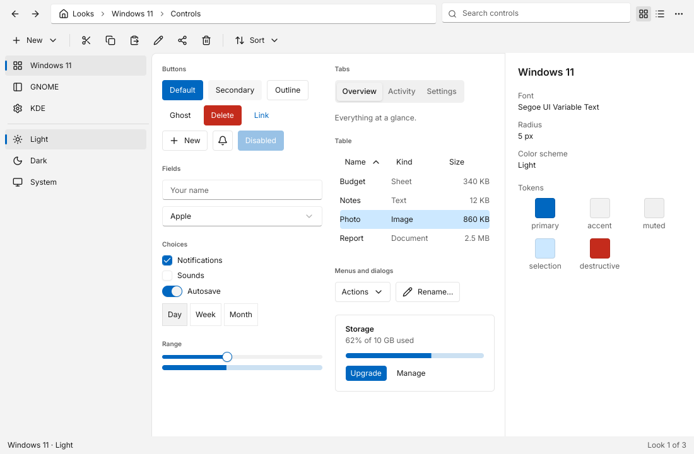
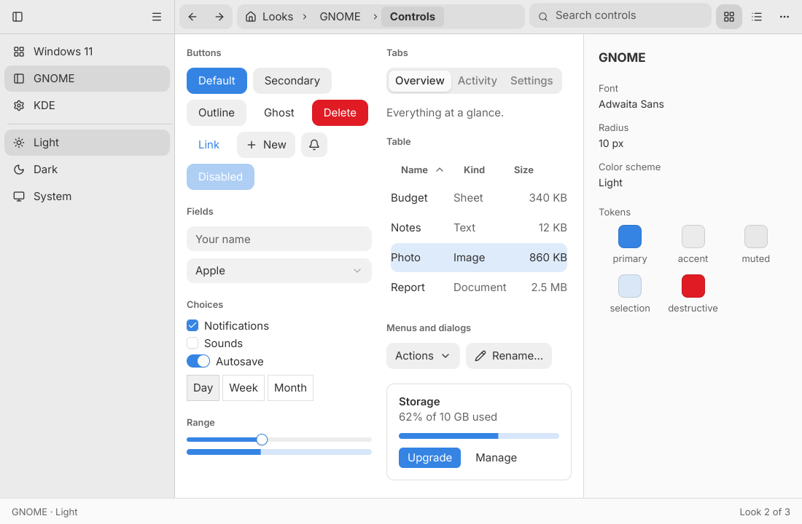
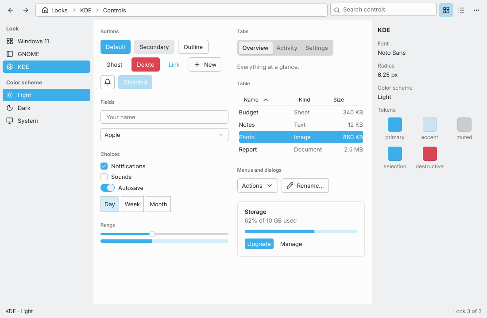

# Platform looks for Tela

The looks of Windows 11 (Fluent), GNOME (libadwaita), KDE (Breeze) and macOS
(Aqua, in two designs, Tahoe and Sequoia), each in light and dark, as values an
app can adopt. A separate module
(`github.com/kuronosu/tela/looks`, ADR-197), like `icons/lucide`: `kit` stays
platform neutral and the looks change at their own pace.

<p align="center">
  
  
  
</p>

A look is the three levels of kit's customization (ADR-129):

| | |
|---|---|
| `Theme` | the tokens: colors with a light and a dark value (no `dark:` classes), the base radius and the font |
| `Style` | kit's recipes for the look, for `kit.StyleProvider` |
| `Regions` | the classes of the parts of a window kit has no component for: toolbar, location bar, sidebar, content, details pane, status bar |

```go
import (
	"github.com/kuronosu/tela"
	"github.com/kuronosu/tela/kit"
	"github.com/kuronosu/tela/looks/detect"
)

l := detect.Look() // win11, adwaita, breeze or aqua, by the running desktop
tela.Main(tela.App{
	Title: "Files",
	Theme: &l.Theme,
	Root:  kit.StyleProvider{Style: l.Style, Children: Window{Regions: l.Regions}},
})
```

| Package | |
|---|---|
| `looks` | the types `Look` and `Regions`, and the `Toggle` variants `Sidebar` and `Toolbar` that every look defines |
| `looks/win11`, `looks/adwaita`, `looks/breeze` | `Look()`, `Theme()` and `Style()` of each look |
| `looks/aqua` | `Look(opts ...Option)`: macOS, with the designs `Tahoe` (default) and `Sequoia`, mixed per part with `Controls(d)`, `Chrome(d)` and `GlassContent()` (below) |
| `looks/detect` | `Look()`: Windows is win11; Linux with `KDE` in `$XDG_CURRENT_DESKTOP` is breeze, otherwise adwaita; macOS is aqua, Tahoe from macOS 26 and Sequoia before it. `For(goos, desktop)` for a given system and `All()` |
| `looks/gallery` | `package main`: kit's controls in a look, with a switch between looks and schemes at run time |

`looks` cannot import the look packages (they import it for the types), which
is why the choice of the running desktop is `looks/detect`, a package above
all of them. An app with one fixed look imports that package alone.

Besides kit's tokens every look defines `toolbar`, `sidebar`, `field`, `edge`,
`selection` and `selection-foreground`, and the glass tokens of Aqua (`glass`,
`glass-strong`, `glass-selected`, `glass-edge`, `glass-highlight`,
`glass-shadow`, `primary-glow`, `control-shadow` and `segment`; see the package
documentation), so the classes of any look resolve under any look's theme.

## macOS: Tahoe, Sequoia and a mix

`aqua.Tahoe` is the Liquid Glass of macOS 26: capsule controls, a toolbar whose
groups are floating glass and a sidebar that is an inset glass panel, over an
opaque content area. `aqua.Sequoia` is the Aqua of macOS 11 to 15: 6 px
rounded rectangles, a flat toolbar unified with the title bar and a plain
sidebar. Each is an option that sets every part, and the options apply in
order, so an app can mix them:

```go
aqua.Look()                                       // Tahoe
aqua.Look(aqua.Sequoia)                           // Sequoia
aqua.Look(aqua.Sequoia, aqua.Chrome(aqua.Tahoe))  // Sequoia's controls, Tahoe's toolbar and sidebar
aqua.Look(aqua.Tahoe, aqua.Controls(aqua.Sequoia)) // Tahoe's window, Sequoia's controls
aqua.Look(aqua.Tahoe, aqua.GlassContent())        // the content's cards are glass too
```

Glass is a backdrop blur, a translucent fill, a light edge and a highlight: Tela
does not refract, and the fonts and symbols are Inter and Lucide, never
Apple's. Each glass piece costs a backdrop blur on the CPU (cached while what
is behind it does not change); Sequoia has none.

## The gallery

```bash
cd looks
CGO_ENABLED=0 go run ./gallery                       # the look of this OS, light or dark as the system says
CGO_ENABLED=0 go run ./gallery -look=breeze -dark=true      # also tahoe, sequoia and mixed
LOOKS_LOOK=breeze CGO_ENABLED=0 tela snapshot --size 1100x720 --dark -o gallery.png ./gallery
```

The sidebar (or the menu, or the toolbar's arrows) switches look with
`tela.SetTheme` and a new `kit.StyleProvider` style. Tests
(`CGO_ENABLED=0 go test ./...`) hold goldens of every look (aqua's Tahoe, Sequoia and a mix of both) in both schemes at
1100x720 (the Windows 11 light one also at scale 2), and of each look with the
dialog (light) and the menu (dark) open (`gallery/testdata`; regenerate with
`TELA_UPDATE=1`).

## Limits

- The looks are an approximation drawn from memory of each platform: colors,
  radii and metrics are close, not measured. Window controls, native menus and
  icon theme fidelity are not reproduced. Each look asks for its platform's font
  (`Segoe UI Variable Text`, `Adwaita Sans`, `Noto Sans`); the embedded Inter is
  the fallback, and goldens always get Inter.
- A `kit.Table` has no row element, so a row's selection and hover are painted
  by its cells.
- Only the controls the gallery shows (and the ones the recipes list) are tuned
  per look; the rest of kit uses its default recipes with the look's tokens and
  text size.
